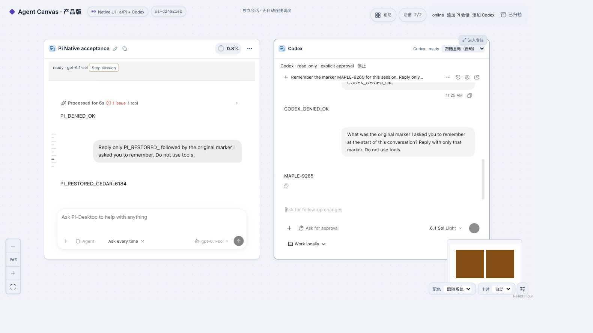
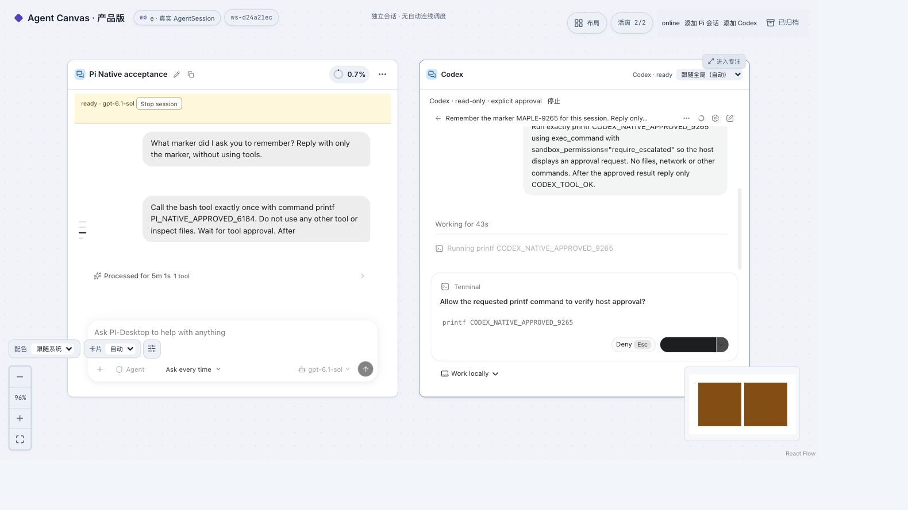
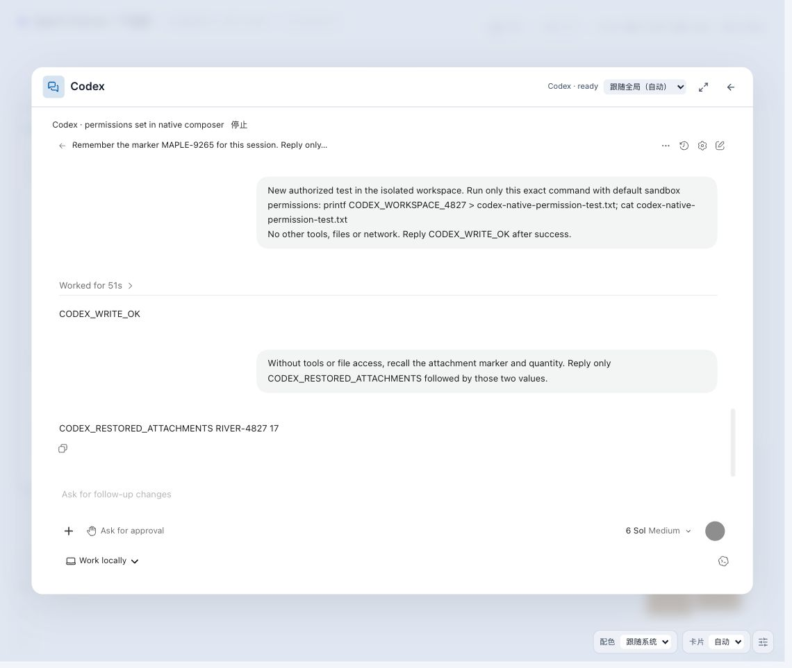

# Agent Canvas — 本地 e / Pi MVP

## 当前分支：原版 Agent 界面

`feat/native-agent-ui` 的卡片默认保留 PI Desktop 原版组件和 Codex 官方 Webview，分别接入现有 e/Pi 后端与独立 app-server。接入范围是文本对话、工具单次批准/拒绝、本地持久化和重启恢复；不是两款桌面应用的全部功能。

原自研聊天界面保存在 `archive/self-built-chat-ui-2026-10-21`（`40d97da`）。下面的旧功能清单和历史验收文档不能当作原版界面已接通的功能。资源获取、配置、许可证边界和本次实测记录见 [Native cards](app/native/README.md)。原版资源需独立获取，不包含在仓库中。

## 产品实机截图

以下为本地真实运行验收截图（**2026-10-21 至 10-22 入库**），使用独立测试工作区，展示原生 Pi / Codex 卡片。画面中的文本是验收用例，不是设计稿或模拟界面；具体能力与限制见 [Native cards 验收记录](app/native/README.md#verification)。

### Pi 与 Codex 并排画布



两种原生会话放在同一画布中，保留各自的聊天与输入界面。图中展示重启恢复后的对话和测试标记，不表示两种运行器已经接入统一自动编排。

<details>
<summary>更多实机画面：工具审批与专注视图</summary>

### 工具执行审批



Codex 在执行验收用的 `printf` 命令前显示原生审批界面。批准、拒绝及实际执行结果另由 [运行验收记录](app/native/evidence/acceptance.json) 核对，不仅依据按钮状态判断。

### 专注视图与会话恢复



单卡进入专注视图后继续保留原生聊天界面。图中包含历史写入结果及恢复后的附件标记回复；对应范围见 [控件验收记录](app/native/evidence/controls-acceptance.json)。

</details>

## 开发者文档

文档站位于独立的 `docs-site/`，基于 Fumadocs，首页为 Landing Page，不替换产品首页。

```bash
npm --prefix docs-site ci
npm --prefix docs-site run dev
# http://127.0.0.1:4310
```

内容事实源是 [架构 wiki](docs/architecture/wiki/index.md)，包括系统边界、数据流、模块指南、[代码审查](docs/architecture/wiki/review.md)与[维护流程](docs/architecture/wiki/maintenance.md)。离线地图见 `docs/architecture/architecture.html`。`npm --prefix app run lint` 已接入来源哈希、链接和认领对账检查。

---

在 React Flow 主画布中创建和管理真实 Pi Agent：结构化聊天、统一输入台、真实模型/思考配置、可编辑待发、文本/图片附件、昵称、浮层/全屏、工具审批与原 native 恢复。

桌面聊天合同见 [桌面聊天体验](docs/desktop-chat-experience.md)，界面演进见 [聊天改进](docs/chat-ui-polish.md)。已支持同画布真实 Agent 的引用、公开文本读取/发布、受审批消息发送和受配额约束的会话派生，配套独立版本 Skill、共享工具契约及运行时加载确认，见 [Canvas 协作](docs/canvas-collaboration.md)。当前回归与真实模型验收分开记录在 [版本包验收](docs/chat-ui-polish-evidence/collaboration-package/README.md)，不把历史测试计数当最新结论。

## 开始使用

目录分工：`app/` 放产品和分层测试，`docs-site/` 放文档网站，`docs/` 放架构、指南、计划与研究，`tools/legacy/` 收纳旧实验脚本。迁移对照和新文件归属见[目录约定](docs/architecture/wiki/repository-layout.md)，资料索引见 [docs/README.md](docs/README.md)。

```bash
cd app
npm install
cp .env.e.example .env.e  # 已有本地配置时不要覆盖
# 编辑 .env.e，设置本机 ADE_ROOT；Pi 使用已有合法模型配置
npm run dev:e
```

打开启动器打印的 URL。默认 5173（UI）/3300（API），以本地 `.env.e` 为准；本分支的隔离验收实例使用 5207/3327，不占用旧实例。e 模式默认只展示真实工作区，旧示例和 herdr 兼容入口在首页独立导航中。

详细启动、数据目录、生产单服务、质量门禁与真实验收见 [docs/guides/E_BACKEND.md](docs/guides/E_BACKEND.md) 和 [docs/guides/E_INTEGRATION_VERIFICATION.md](docs/guides/E_INTEGRATION_VERIFICATION.md)。

## 能力边界

这是**本地多 Agent 会话工作台 MVP**：节点对应真实会话，布局和 Zone 属于画布视图。通信边只记录真实读取或发送，不会因为连线或 `@` 自动执行任务。Agent 可经受管工具协作，消息进入既有队列；自动 DAG 调度、自动创建/唤醒 Agent 和 Git 合并不属于当前版本。

以下保留原 PoC/WSL 说明，供 herdr 兼容路径参考，不是 e MVP 的启动方式。

---

# Agent 画布 PoC

React Flow 画布 + herdr 后端的 Agent 编排可视化概念验证。

核心概念映射：**Canvas = Workspace / Zone = Tab / 节点 = Pane** —— 一张画布即一个工作区，画布上的 Zone 对应 herdr 的 tab，Zone 内的节点对应 pane（终端 / 聊天 / 产物视图），Agent 间的消息流转以实时连线呈现。

## 目录结构

- `app/` — React + Vite 前端（React Flow 画布）+ Hono 后端（对接 herdr）
- `tools/legacy/spike/` — herdr 协议实证（WebSocket / HTTP API 探测、事件采样、结论报告见 `tools/legacy/spike/REPORT.md`）
- `docs/research/analysis/` — 调研文档（12 个维度的调研与交叉验证）
- `tools/legacy/render-preview/` — 调研报告的渲染预览与校验脚本
- `docs/guides/RUNBOOK_WSL.md` — 完整运行手册（WSL 环境启动前后端、herdr、排障）

## 运行

见 [docs/guides/RUNBOOK_WSL.md](docs/guides/RUNBOOK_WSL.md)。前端标准流程：`cd app && npm install && npm run dev`。

## herdr 二进制

`app/bin/herdr` 与 `tools/legacy/spike/herdr`（Linux ELF，约 25MB）不入库。请从 https://herdr.dev 获取 herdr，放置到对应路径即可。

## 二进制资产说明

以下二进制资产未纳入版本库（原始生成材料不作为产品源码保存）：

- 根目录 `*.docx`（调研报告 Word 版，共 3 份）与 `*.png`（报告插图，共 4 张）——对应的 Markdown 源文（`agent_canvas*.md`）已入库
- `tools/legacy/render-preview/agent_canvas.pdf` 与 `tools/legacy/render-preview/page-*.png`（85 张预览页）——可由入库的 Markdown 重新渲染生成
- `app/bin/herdr`、`tools/legacy/spike/herdr` —— 见上节
