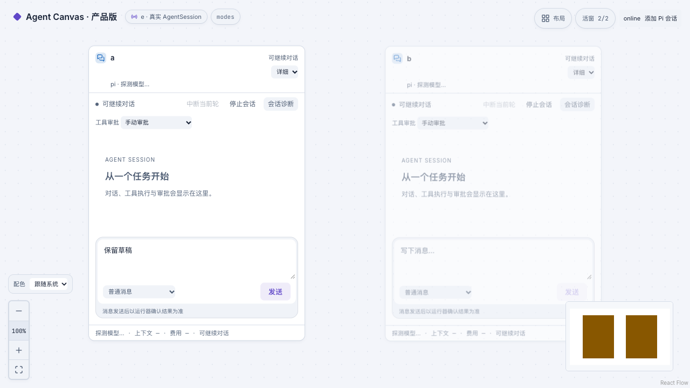
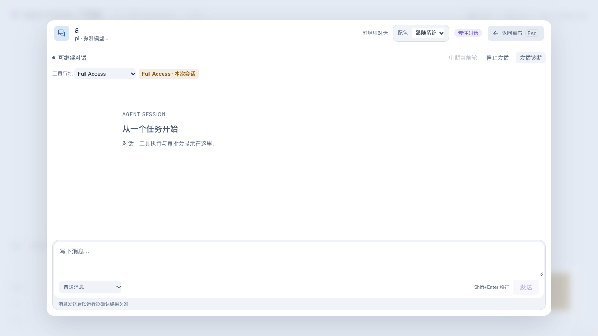

# 卡片独立视图与会话审批模式

## 全局与单卡视图

主画布的全局“卡片”选择器位于“配色”旁，支持自动／缩略／详细，作用于本浏览器同源的所有主画布和新增卡片。浮层与全屏期间仍能访问；不会启停 Agent 或发送消息。

单卡标题菜单中的“卡片视图”可选：
- **跟随全局**：默认设置，采用当前全局值，并显示其名称。
- **自动（随缩放）**：这张卡片始终按屏幕宽度决定档位，不随全局固定为缩略/详细。
- **缩略**：这张卡片固定摘要。
- **详细**：这张卡片固定详细聊天。

优先级为 **专注窗口 > 单卡覆盖 > 全局默认 > 自动缩放档位**。全局切换保留单卡覆盖，不悄悄清除用户选择。若要统一当前画布，点击全局选择器旁的设置入口，使用“本画布全部跟随全局”；只清除当前 workspace 的显示覆盖，不影响其他画布。

全局值保存在 `canvas.card-view.global.v1`，单卡覆盖保存在 `canvas.card-views.v2:<workspaceId>`。未有 v2 时读取旧 v1 的 compact/detail 设置，保留原选择，不删除旧记录；明确清除覆盖写入空 v2 对象，避免旧设置再次出现。全局和单卡偏好均支持同源标签页同步，存储不可用时当前页面仍可在内存切换，但不承诺刷新后保留。

切换不会改变会话、审批权限、队列或消息。专注内容保持同一 DOM、草稿和阅读位置，返回画布后才应用所选卡片档位。独立 `/react-flow`、`/tldraw` 原型不继承主画布全局默认。最新检查见 [UI/UX 记录](chat-ui-polish.md)。

## 三档工具审批

当前入口已收纳在底部统一 Composer 的“权限设置”浮出菜单，Full Access 风险在入口常显；审查模型、精确授权和规则保持。最新体验与验收见 [桌面聊天体验](desktop-chat-experience.md)。

### 手动审批

默认模式。工具是否需要审批由现有 e/Pi 适配器决定，通常 bash/write/edit 提出审批；并非所有只读内置工具都会产生审批。

### 帮我审批（白名单＋独立 AI）

选择“帮我审批”后，必须显式选择审查 provider/model，再点击“启用辅助审批”并确认。选择仅用于这个会话的审查，不更改 Pi 全局默认；待审参数和当前用户任务会发送给所选模型，可能产生额度消耗。

执行顺序：
1. 完整工具参数、工具名称一致性和当前审批身份检查。
2. 精确低风险白名单直接代为提交批准。
3. 强制人工规则优先于 AI，不能被模型豁免。
4. 其余允许审查的范围交给独立无工具 Pi 审查进程；只有严格 JSON 的 approve + low 才能提交批准。
5. 审查完成后再次核对会话 native ID、epoch、策略代次、审批参数摘要、pending 状态、文件边界以及能力有效性。
6. 失败、超时、输出不合法、风险非 low 或不确定均转人工，不自动重试。

**当前白名单 v1（固定规则，不支持用户任意添加 shell 模式）：**
- `pwd`
- `git status` 及明确的 `--short / --porcelain / -s` 形式
- `git diff` 及 `--stat / --name-only / --numstat` 形式
- 项目目录范围内的 `ls`，仅简单 `-a/-l/-h` 参数组合

不靠命令前缀判断。**审批策略 v2 不再因为出现引号、管道或顺序命令就直接转人工**；这些语法通过有界解析后交给 AI，不扩大直接批准白名单。

**允许进入 AI 审查的范围（策略 v2）：**
- 支持的普通 shell 命令：`pwd`、有限 `git status/diff`、项目内 `ls`、`cat/head/tail/wc`、有限 `rg/grep`、普通 `echo`；正常引号与 `| / && / || / ; / 换行` 命令链逐段检查。每段都必须通过规则，不能藏危险尾命令。
- 完整可见的 `node -e/--eval`：使用 Acorn AST 检查，只支持 builtin fs/path、静态可验证的项目内读取、JSON/数组等普通数据处理和 console 输出。只读文件 ≤256KB；动态文件路径、脚本文件、任意模块、函数加载、环境读取、未知调用均转人工。不是通用 JS 安全证明。
- 已通过共享参数契约的 `canvas_agents/read/publish/send`：交独立 AI 判断是否服务于原始人类任务、是否涉及敏感信息；不新增直接批准白名单。私有身份、同 Canvas、不可变产物、队列/预算与 e 的真实批准证据仍由服务端强制执行。
- 项目内不存在的新文件，内容 ≤8,000 字符。
- 项目内已有常规文件的唯一匹配、小范围精确替换：oldText ≤2,000、newText ≤4,000 字符，文件 ≤256KB。
- 参数缺失/矛盾、越界/符号链接、敏感路径、删除/空替换、覆盖、大范围内容、隐藏配置/依赖清单/启动脚本、涉及执行/网络/敏感行为时先转人工。

**仍然先转人工：** 重定向（包括写文件）、变量/命令替换、后台/分组/未支持语法、未闭合引号、任意脚本/包装器、删除、凭据、外传/外部网络、安装、提权、Git 写入及大范围覆盖。`npm test` 等可能执行不可见项目脚本的命令并不因常见而自动进入 AI。搜索目录有数量/文件大小上限，隐藏路径、敏感文件和符号链接受保护；无法完整检查时给出具体原因。

未列白名单的任意 shell **不会**交给 AI 自由放行。支持语法、白名单和 AI 都不是 OS 沙箱；文件预检也不能消除实际执行前的文件系统竞态。独立 AI 判断可能出错。任务、参数、Skill 与同伴内容都是不可信待审材料，不得修改审查规则；有来源标记的 Agent/未知消息不会替代人类任务上下文。

审查器使用显式 provider/model、低思考级别，`--no-tools --no-session --no-extensions --no-skills --no-prompt-templates`，独立临时 cwd，最长 45 秒、最多 2 个并发。审查自身不调用文件/命令工具，也不写执行会话的历史。

### Full Access

必须单独确认。当前待处理及后续工具审批会自动提交批准，不经过白名单或 AI；仍通过 e 的官方审批接口，不绕开会话身份与能力校验。

- 仅当前会话运行实例生效，不改变其他卡片。
- 持续显示 Full Access 标识，缩略卡也能看到。
- 不是 OS 提权，也不是目录沙箱，Agent 可以使用进程已有权限访问资源。
- 随时切回手动。停止、恢复、API 重启或运行时中断后回到手动。
- 已提交或已经执行的操作无法通过切换模式撤回。

## 取消、去重与审计

人工审批、切换策略、参数变化、会话代次变化或停止都会使旧 AI 结果失效；请求绑定摘要在 worker 端再次核对。自动批准使用稳定 intent ID，超时结果不盲目重发。人工仍可在 AI 审查期间批准/拒绝。

节点“授权范围与记录”以及审批卡区分：规则转人工（未调用 AI）、未启动 AI（缺审查模型/任务）、AI 审查中、AI 审查后转人工/失败、已提交待 e 确认。`reviewAttempted` 仅在真正开始调用审查器时置为 true；旧记录不补造调用证据。记录保存在会话 record 中，当前保留最近 100 个状态记录；不包含审查器的思维链。`已提交` 不等于工具执行成功，真实 approval/tool 结果仍以 e 为准。

## 策略 v2 的启用与验证

`SessionView.approvalPolicyVersion` 由运行中的 API 写入，当前为 `2`，不从历史授权恢复。缺少该字段的 API 视为旧版；权限详情提示安全重载。**Vite 热更新/刷新页面不意味着 API 的审批代码已更新。** 日常服务启用要另行选择安全时间重载；不能自动接管既有 pending 请求，也不能复用恢复前的辅助审批授权。

本次实现未重启日常 API、未批准用户 pending 请求、未给真实会话发送测试提示。隔离验收及全量检查结果见 [策略 v2 证据](chat-ui-polish-evidence/assisted-approval-v2/README.md)。真实独立模型测试采用合成任务、无工具进程与测试授权提交端；不冒充真实 e 工具执行验收。

## 第一版历史验证（不作为策略 v2 的验证结果）

- **63 项单测通过**：卡片独立/持久化、旧 auto 与缺确认拒绝、白名单绕过/路径边界、参数绑定、AI 严格结果、审查取消/模式变化/人工覆盖、失败转人工、独立审查进程无工具、停止/恢复重置权限等。
- **18 项浏览器 fixture 通过**：新增卡片独立切换、缩放、刷新、草稿保留；审批模型显式选择、Full Access 接受/取消确认、切回手动；原聊天、主题、诊断回归保留。
- 全量 lint、API/UI build、diff check 通过。
- 真实 AI 审查：使用 `openai-codex/gpt-6-astra`，返回 approve/low；仅审查，没有执行操作。
- **真实端到端策略验收通过**：独立 scratch 项目中 `pwd` 白名单批准；创建无害 hello.ts 经独立 AI 审查批准并实际写入；Full Access 下 printf 自动批准；切回手动后新请求停在 pending；停止后权限为 manual。
- 测试没有在用户实际项目里开启自动审批或自动执行工具。全局 provider、模型和凭据未改。

真实证据：本轮 scratch `card-approvals/real-review.json` 和 `real-policy-evidence.json`。

## 界面截图（fixture）

## 已知边界

本地工作台信任已授权的本机用户；不是多租户权限系统，也不是沙箱。白名单固定且保守，AI 只覆盖上述限定范围；无法证明安全的请求继续人工。文件最终执行仍存在外部进程并发修改风险，不能把应用层路径核对宣传成 OS 隔离。Full Access 必须由用户明确承担自动操作风险。
