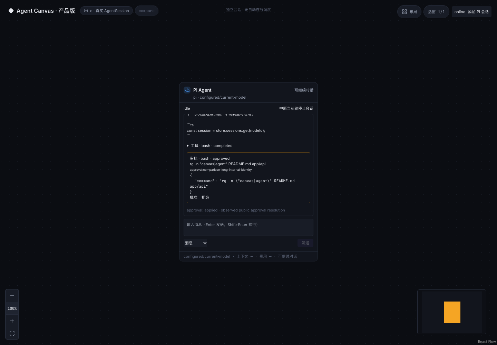
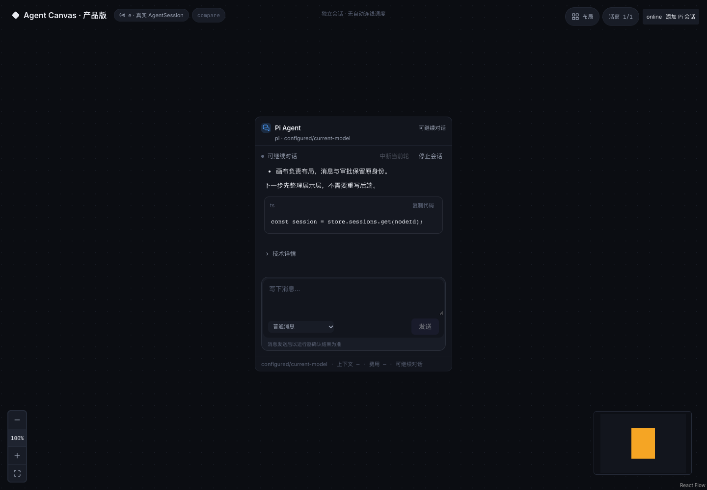
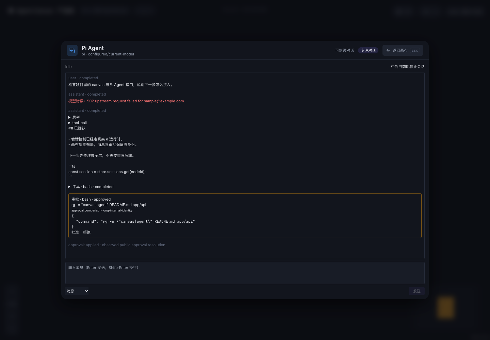
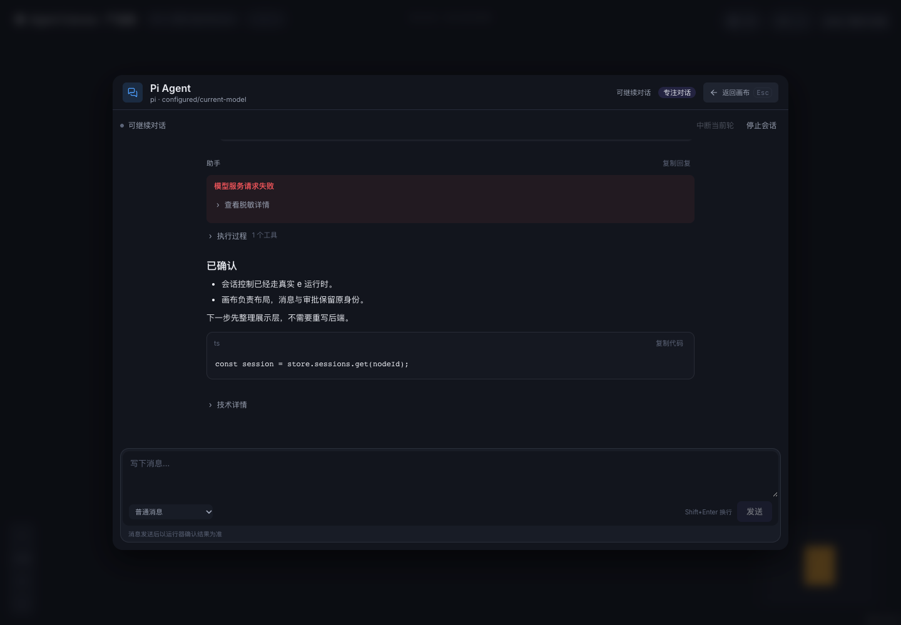

# 结构化对话体验升级

> 本文保留较早阶段的实现与验收历史。当前统一输入台、忙时待发、附件、昵称/全屏与最新门禁见 [桌面聊天体验](desktop-chat-experience.md)，取代下文已过时的“无附件/忙时禁止普通提交”等描述。

## 状态

本次在 `agent-canvas-e / feat/agent-canvas-e` 内完成新版对话展示与交互，保留 e 为唯一会话/执行事实源。原画布入口、Pi runtime、审批权限、控制路由、模型默认配置与 canonical 持久化数据未被重写。

**展示/交互自动化验收通过；用户重新登录后，新版主画布的真实回复、恢复、审批、中断、Steer/Follow-up 和多会话隔离回归也已通过。此前 401 阻塞已解除，详见文末。**

## 交互参考与实现来源

参考 PI-Desktop 的轮次组织、过程收纳、阅读体验，参考 AI Elements 的待审批/已决状态区分。没有复制其组件源码、样式资产、图标或品牌，也没有引入 Electron、PI-Desktop store、assistant-ui、CopilotKit 或 AI SDK runtime。

代码为针对 e 契约独立实现；以下通用基础库以固定版本引入：

| 依赖 | 版本 | 许可证 | 用途 |
|---|---|---|---|
| react-markdown | 10.1.0 | MIT | Markdown → React 元素，不启用原始 HTML |
| remark-gfm | 4.0.1 | MIT | 表格、列表等 GFM |
| use-stick-to-bottom | 1.1.6 | MIT | 底部跟随与用户逃离滚动锁 |
| shiki | 3.22.0 | MIT | 按需加载有限语言与主题；返回 token，不注入 HTML |

分发时保留这些包附带的许可证/版权声明。没有升级 React 19 / Tailwind 3，也未增加数学、Mermaid 或执行型代码预览。

## 数据与组件边界

`SessionSnapshot → TranscriptProjector → TranscriptTurn → ConversationView/TurnView`。

- `app/api/e/contracts.ts` 显式声明可选 run/turn/parent/tool、revision、时间与错误字段；向后兼容。
- `chat/project-transcript.ts` 根据真实 ID 关联消息、工具、审批，去重 tool-result 与 canonical tool。相同 turn 内插入用户引导时切开助手展示片段，避免挪动上下文。
- 缺少关联的记录保留为“未关联活动”；未知内容块可展开查看，不猜测归属。
- `chat/presentation-state.ts` 分开连接状态、运行生命周期、run、消息失败和 action 确认状态。`completed + error` 不显示成功；历史错误不自动等于当前失败；没有数据就不推断“重试中”。
- `SessionStore` 按 node 订阅；会话正文更新不触发整图布局重建。节点摘要/位置和完整对话使用不同通知路径。
- `LiveChat` 只是组合入口；旧 `EApprovalCard` 保留为兼容封装。

## 阅读体验

- 用户正文与助手 Markdown 为主，思考/工具收进按执行顺序排列的过程区。
- 已完成过程默认折叠；运行中或失败工具默认展开，用户选择的展开状态保留。
- 工具结果只显示一份，参数/输出按需展开；长输出初始 4,000 字符，再按 8,000 字符展开。
- 普通历史初始渲染最近 30 个展示条目，每次向前加载 30 个；所有 pending 审批独立挂在待处理区，不受历史窗口遮挡。
- 只有 pending 审批有操作按钮；approved/rejected/cancelled 收为简短结果。审批显示匹配 tool-call 的完整参数，只有上游摘要时明确提示可能截断。
- 协议 ID、action reason、revision、capability 和 system 记录进入“技术详情”；未知、失败、过期未确认动作仍有主区域提示。
- 模型错误、技术详情及诊断复制统一脱敏账户邮箱、Bearer/key 字段和敏感 URL 参数，不改原始证据。
- 链接仅接受无内嵌凭据的 HTTP(S)；不自动加载图片，不打开本地文件，不执行 HTML。过长/未知语言代码回退纯文本，超过 16,000 字符不高亮。

## 草稿、幂等和阅读状态

- 编辑草稿与发送资格分离：运行中、停止、短暂离线可以输入；只读/归档工作区不允许编辑或发送。
- 普通消息等待 run 结束；Steer/Follow-up 需用户选择且有有效能力。不自动转发送模式，不自动重试任务。
- Enter 发送、Shift+Enter 换行、IME 组合状态不提交。提交只捕获当时草稿 revision；晚到回执不清空随后编辑的新内容。
- 同一未决意图的显式重试保持 intent ID，成功后再次发送相同文字则生成新 ID。
- UI store 按 workspace/node/native 身份隔离，内存保留展开状态与阅读锚点；同标签页 sessionStorage 保存草稿、模式与未决意图，24 小时有效、草稿上限 100,000 字符。存储受限时退回内存，不上传草稿。
- L0 卸载、节点重新出现、专注 DOM 搬迁、WS 重连保留 UI 状态。同 native 恢复不丢草稿，新的 native 身份不自动继承旧草稿。
- 锚点使用条目 ID + 可见偏移；专注尺寸变化期间抑制容器搬迁引发的伪滚动记录。用户滚轮/触摸/拖滚动条优先打断自动恢复。
- 向上阅读时不强制到底部，显示“回到最新”。选择文本不追流；reduced-motion 不做平滑动画。

## 本次验证

| 检查 | 结果 |
|---|---|
| 单测 | 44 passed：原 27 项 + 17 项展示/状态/草稿/脱敏回归 |
| 全量 lint | 通过，无禁用规则 |
| API build | 通过 |
| UI build | 通过；高亮语言/引擎为异步分包 |
| 开发浏览器 fixture | 10 passed；真实模型用例默认 skipped |
| 生产单服务浏览器 fixture | 10 passed，含深路由刷新 |
| L0/专注/刷新草稿测试重复运行 | 连续 3 次通过 |
| 旧 herdr 终端专注 | 浏览器 fixture 回归通过，未启动真实 herdr 命令 |
| 真实 Pi 回归 | 创建与输入 applied 成功，模型回复失败，见下文 |

浏览器覆盖：截图同类工具/审批收纳、Markdown 表格和脚本安全、断线草稿、IME、提交期间编辑、已决审批按钮消失、长代码/输出分段、焦点不被流式抢走、序号断档重同步、重复帧、L0/专注阅读锚点、旧终端专注。

性能 fixture：4 个节点，每节点 500 条消息；每节点初始只挂载 30 个条目，加载更早后 60 个。向另一节点推送 15 次更新，当前专注对话 DOM 无变化、阅读位置保持。实测场景完成约 1.7–3.4 秒（本机 Chrome，含导航/加载/交互，不是纯渲染基准或 FPS 保证）。本次不增加服务端分页。

### 真实回归阻塞

使用独立 5203/3323 服务和 scratch 数据目录，未中断日常 5199 会话。默认模型发送得到 e `applied`，但上游错误明确包含刷新 OAuth 登录态 `401 Unauthorized / Your session has ended. Please log in again.`，被本地代理包装为 502。

因此本轮没有再次完成真实回复、工具批准/拒绝、中断与 Steer/Follow-up 的全链路验收。没有切换账户/模型、修改凭据、自动重发或使用 fixture 冒充真实成功。原控制协议单测、浏览器审批/停止/恢复 fixture 均通过。待用户修复模型代理登录态后，使用现有 opt-in 真实脚本重跑。

内置浏览器面板因当前会话不可见无法操作；使用实际 Chrome/Playwright 验证和截图，不声称已人工检查面板。

## 同数据前后对比

以下均为标明的 fixture，不包含真实账户或用户任务内容。旧渲染器只在 scratch 副本中运行，没有覆盖项目。

### 节点内

| 改版前 | 改版后 |
|---|---|
|  |  |

### 专注模式

| 改版前 | 改版后 |
|---|---|
|  |  |

## 验证命令

在 app 目录：

```bash
npm run lint
npm test
npm run build:api
npm run build
npm run test:e2e
# 需要已恢复的模型服务，显式运行，可能消耗模型额度：
CANVAS_REAL_E2E=1 CANVAS_TEST_URL=http://127.0.0.1:<验收UI端口> npm run test:e2e -- --grep 'real Pi responds'
# 真实工具与运行中消息脚本（独立测试目录）见 E_BACKEND.md。
```

刷新当前运行的 Vite 页面即可取得前端更新；本轮不为了更新 API 投影而重启用户会话。后端新增的归档状态广播与安全摘要在正常下一次 API 重启后生效；新验收/生产服务已验证该版本。

## 剩余边界

不增加自动 Agent 调度、附件上传、语音、消息历史编辑/分支或模型自动切换。未改变真实执行权限。外部链接不是安全沙箱；工具参数可能包含敏感内容，诊断脱敏是展示防护而非完整 DLP。所有未知/未确认结果保留，不伪造成功。


## 重新登录后的真实回归：通过（取代上述登录态阻塞结论）

用户重新登录后，使用原默认模型，未切换账户/provider 或修改默认配置：

- 新版主画布真实 Playwright：1 passed（28.6s）；创建、随机标记回复、上下文追问、刷新、停止及恢复原 native 会话。
- real-tools：真实工具批准与拒绝通过；abort action applied，run cancelled。
- real-multi：Steer/Follow-up 均 applied，实际收到后续回复；跨工作区隔离和同图多节点身份独立通过。
- 本轮只运行既有验收脚本，使用独立数据目录，未修改 runtime/UI 实现，未重发用户任务。
- 此前上游 OAuth 401 阻塞已解除。上文保留为历史诊断，不代表当前状态。
