# 主画布聊天 UI/UX 重构

2026-10-19 · `agent-canvas-e / feat/agent-canvas-e`

> **后续修正：待恢复不再误报故障。** 见文末“待恢复状态与节点密度修正”。本次已在内置浏览器直接查看真实浅色节点、配置浮层和深色专注态；此前目视通道不可用的记录只属于上一阶段。

> **上一阶段：紧凑标题与信息去重。** 会话恢复和菜单合并到标题栏，普通待恢复不再占正文通知块，模型配置保留在输入台、历史消息模型进入详情。见文末“紧凑标题与信息去重”。

> **当前交互：图标权限、自动发送/排队、统一上下文状态球。** 已移除输入台的手动发送方式与独立上下文入口。最新检查为 111 单测、50 浏览器测试通过；本次直接目视了真实页面的 15.8% 用量及单行输入台。见文末对应章节。

> **最新交互：推理主面板＋二级模型列表。** 点击摘要先调整离散推理档位，点击模型名进入真实目录；预览与运行器确认分离。115 单测、58 浏览器用例（含真实 Pi）通过，独立会话的模型/推理回读也已实际验证。见文末“模型与推理两层选择”。

> **新增：全局卡片视图。** 配色旁的“卡片”可设置本浏览器主画布默认视图；单卡可跟随或独立覆盖，当前画布可显式全部恢复跟随。120 单测、63 浏览器用例通过，真实模型用例本轮跳过。见文末“全局卡片视图”。

> **最新展示：连续工具的层级展开。** 同 run 的连续纯工具/思考段收成紧凑摘要，展开工具列表，再按需打开单工具输入/输出；纯执行段不再重复时间戳。173 单测、79 浏览器通过（1 opt-in 跳过），见文末“工具执行层级收拢”。

## 初版重构结论（历史）

已把既有 `/canvas/:workspaceId` 的多层配置表单改为紧凑输入台、浮出设置和独立阅读层级。**实现与自动化几何/交互/真实链路验收通过；人工目视审查未完成。** 后者不以测试通过替代：PI-Desktop 浏览器提示当前会话视图不可见，备用 `orca computer` 提示 `runtime_unavailable`。没有擅自重启用户应用。

本轮与此前“真实聊天功能合同”分开评价。旧功能验收是底线，不能作为本轮视觉质量证明。本文的前后截图使用**相同 fixture 内容、相同视口与主题**；真实 e/Pi 页面另行保存，不把 fixture 当真实模型回复。

### 可直接体验的版本

本次独立生产单服务：

`http://127.0.0.1:3329/canvas/ws-506aff1a`

这是合成验收工作区，运行当前构建。测试项目与数据位于本次会话 scratch 的 `ui-polish/real-project`、`ui-polish/real-data`，不是用户日常项目。开发验收曾使用 3328/5209，切换生产前确认全部验收任务空闲并正常停止，未双写数据。

**日常 3319/5199 未被本轮重启。** 不要拿旧 API 搭配热更新前端的页面作为当前端到端验收实例。若需更新日常服务，先确认所有用户任务空闲，再正常停止并重新启动；本轮没有代为中断任务。

## 界面变化

### 一个输入台

文本区自动增高，达到上限后内部滚动。去除多层底座、textarea 独立边框、手动缩放角与常驻第二层设置。宽屏一条工具栏，较窄节点/视口为明确的两行布局，不靠把文字缩到 10px 塞下所有操作。

- 左侧：附件、当前权限、发送方式。
- 右侧：真实上下文、模型·思考摘要、发送。
- 运行中普通消息明确显示“加入待发”，旁边独立“中断”入口；空闲不常驻禁用中断。
- 附件使用轻量标签，按名称打开原文编辑/安全预览；移除入口保持可访问。
- 待发先显示条数、状态、短摘要，展开才显示编辑/排序等操作。全部消费后变成轻量历史入口，不常驻“待发 0”的空管理面板。

### 权限与模型按需浮出

使用已有 Radix primitives 做局部 Portal 封装，不引入第二套 UI 框架。菜单默认向上打开、避让视口边缘、内部滚动，不占用正文布局。

权限显示模式说明与已选状态；帮我审批仍要求显式选择独立 reviewer；Full Access、辅助审批、跨 provider 与忙时立即发送 Steer 使用应用内确认框。确认框默认聚焦“取消”，Esc/IME 与关闭后的焦点有回归。风险和原有 `confirmRisk` 字段不变。

模型入口展示当前执行模型与思考摘要。菜单内可看完整 provider/model、真实目录、限制原因、回读和错误。离线/停止显示“最后确认”，从未回读则明确未就绪。上下文独立浮层显示真实 tokens、容量与数据时点；无数据只显示中性 `—`。

### 正文和状态

专注正文为 16px / 1.7 行高；节点详细卡保持 14px 的紧凑密度。正文列上限 780px，与输入台对齐。段落、列表、代码、表格分别设置阅读间距，复制与详情为轻量操作，不重复助手标题，也不删除真实来源信息。

- 顶部仍只有一处主要状态灯。
- 正常会话的停止/诊断进入“会话操作”，不占用整条管理工具栏。
- 生命周期问题的原因、恢复和诊断就近显示；消息错误留在原消息，配置错误留在配置与输入阻断处。
- 同一未知队列动作不再重复为正文警告，但独立未确认动作、待审批、Full Access 和缺失附件仍可见。
- 修复窄屏时 React Flow 裁剪原节点、连同专注 carrier 卸载的问题：专注期间保持挂载，退出后恢复正常可见节点裁剪。没有重建真实会话。

## 同数据测量

条件：1440×1000、居中浮层、就绪、空草稿、无附件/待发/告警。实际边界由 Chrome DOM 测量，不是估计。

| 项目 | 改造前 | 改造后 |
|---|---:|---:|
| 输入台高度 | 192.78px | **122px** |
| 权限展开后的输入台高度 | 265.38px | **122px** |
| 展开权限造成的高度变化 | 72.59px | **0px** |
| 展开模型造成的高度变化 | 原界面常驻配置行 | **0px** |
| 专注正文 | 13px | **16px / 27.2px 行高** |
| 输入台可见宽度 | 938px | **776px（780px 内容列内）** |

900×800 与 900×540 窗口输入台也为 122px；390×844 时使用双行工具栏，实测 154px，宽度 350px，没有横向溢出。112–136px 目标只适用于内容区不少于 720px 的标准专注空闲态，不拿窄屏/错误/附件态硬套固定高度。

原始记录：[改造前测量](chat-ui-polish-evidence/before-measurements.json)、[改造后测量](chat-ui-polish-evidence/after-measurements.json)。原版在缩到 390px 后出现 carrier 卸载，基线脚本因此中断；保留记录，不伪造未取得的旧短窗口/异常截图。六组标准节点/浮层/全屏浅深色基线均已取得。

## 同数据前后截图（fixture）

这些图片用于比较布局，不证明模型回复真实性，也不代表已经人工目视审查。

| 模式 | 改造前 | 改造后 |
|---|---|---|
| 浮层·浅色 | 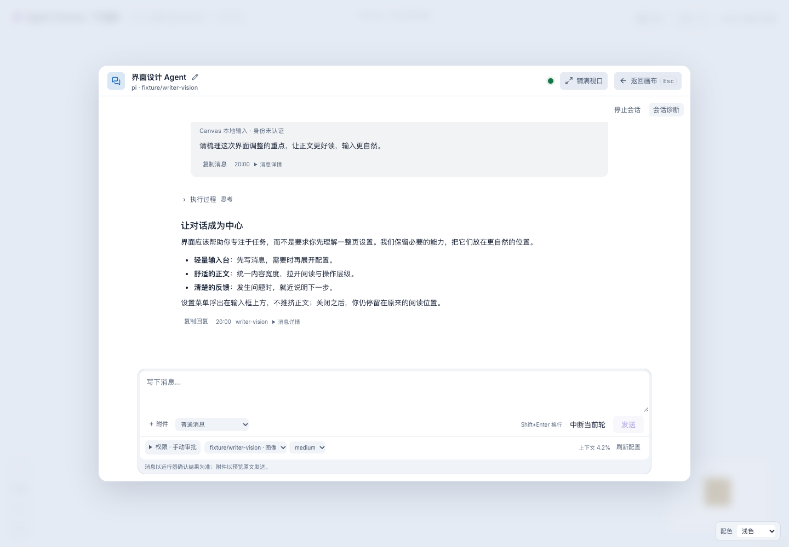 | 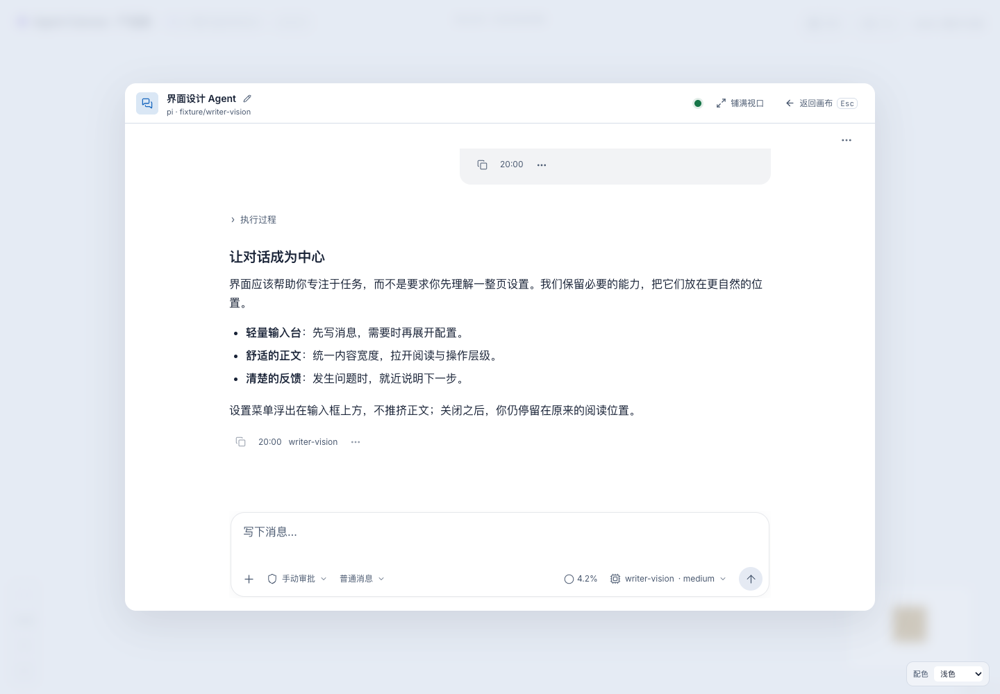 |
| 浮层·深色 | 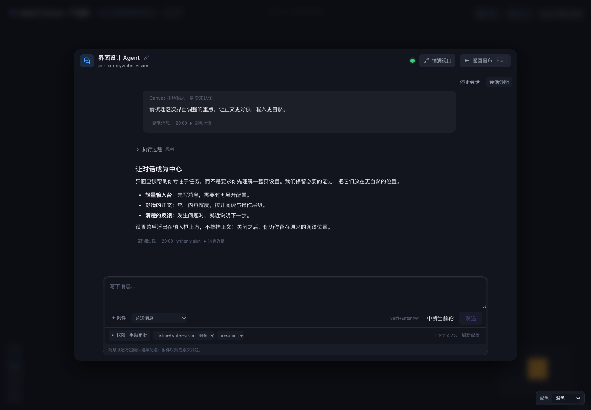 | 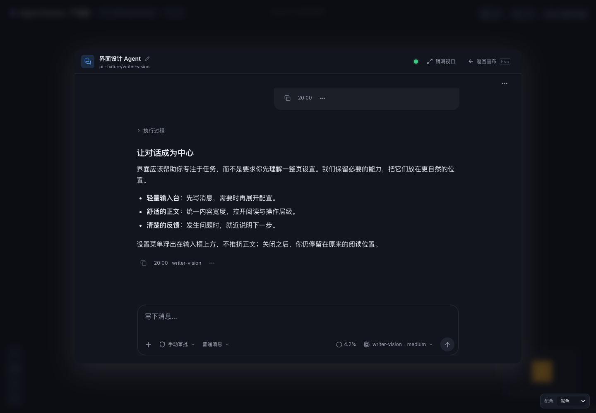 |
| 节点·浅色 | 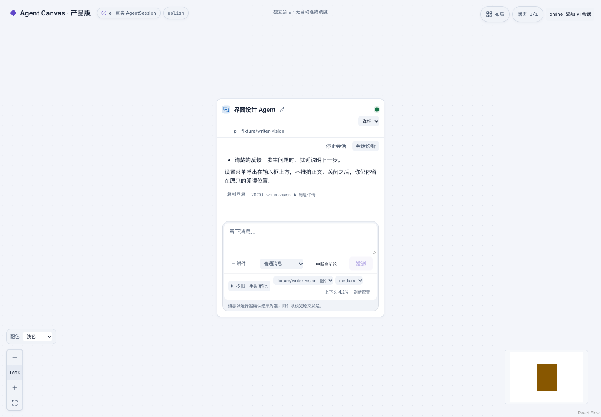 | 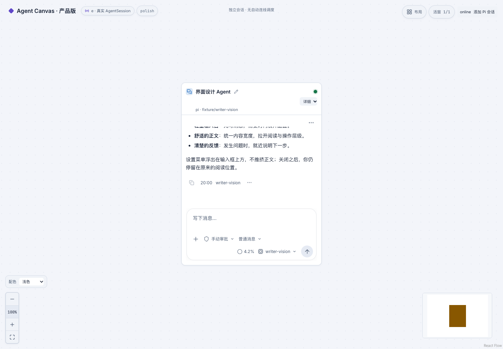 |
| 节点·深色 | 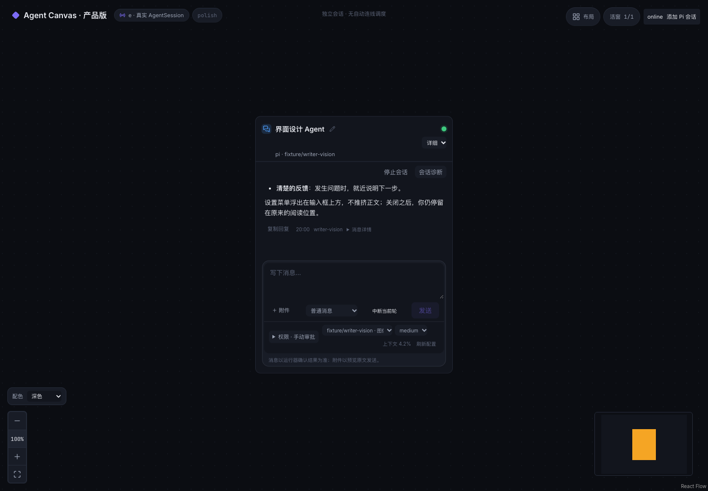 | 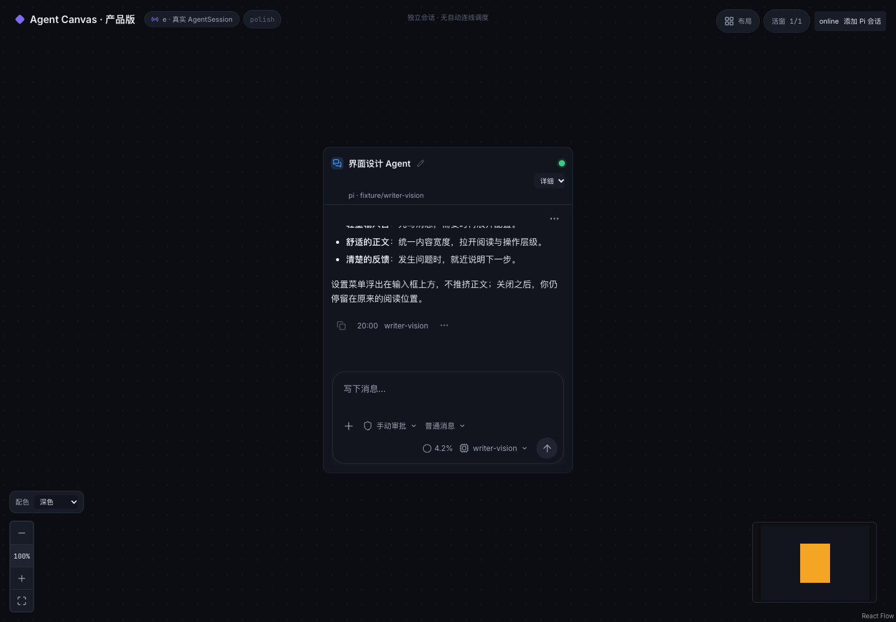 |
| 全屏·浅色 | 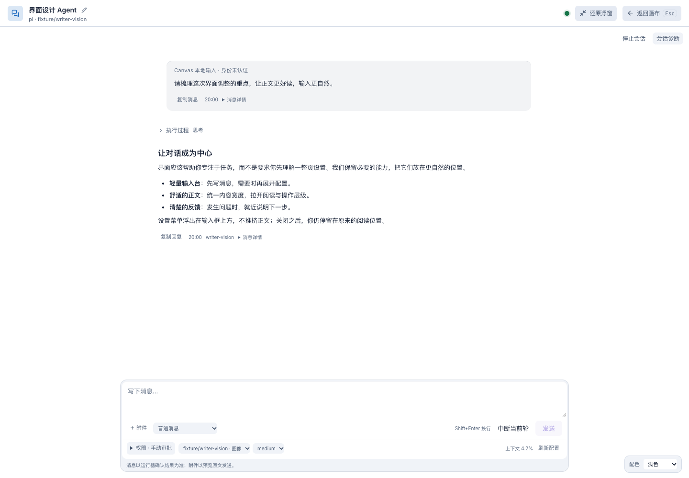 | 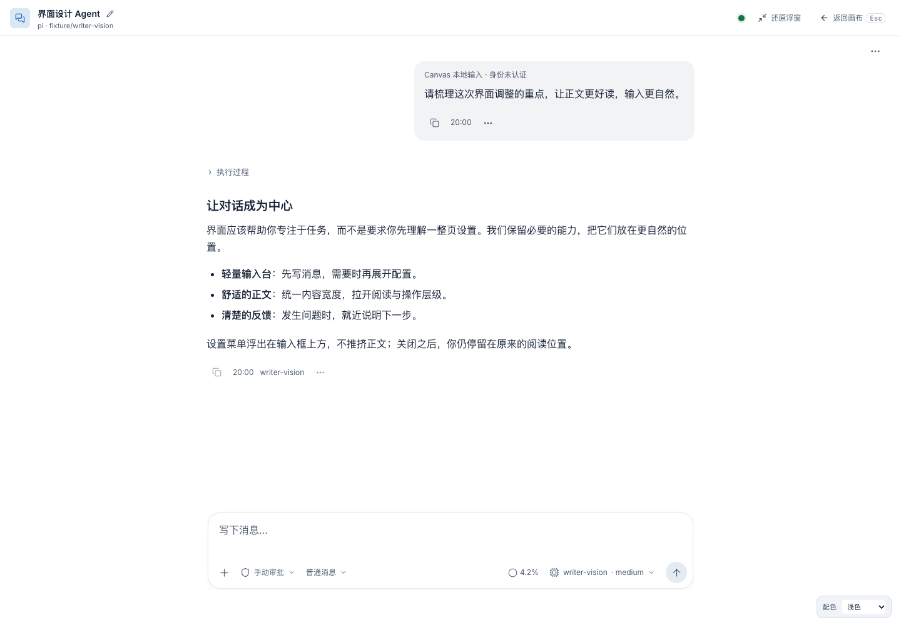 |
| 全屏·深色 | 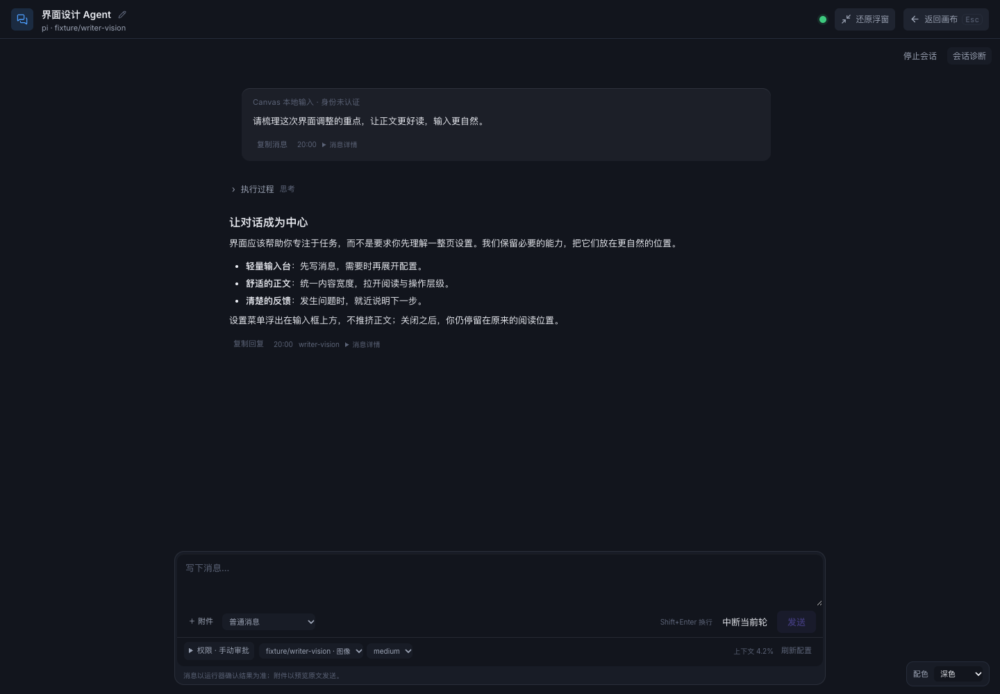 | 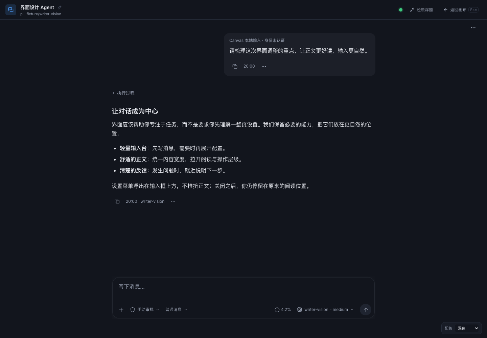 |
| 权限展开 | 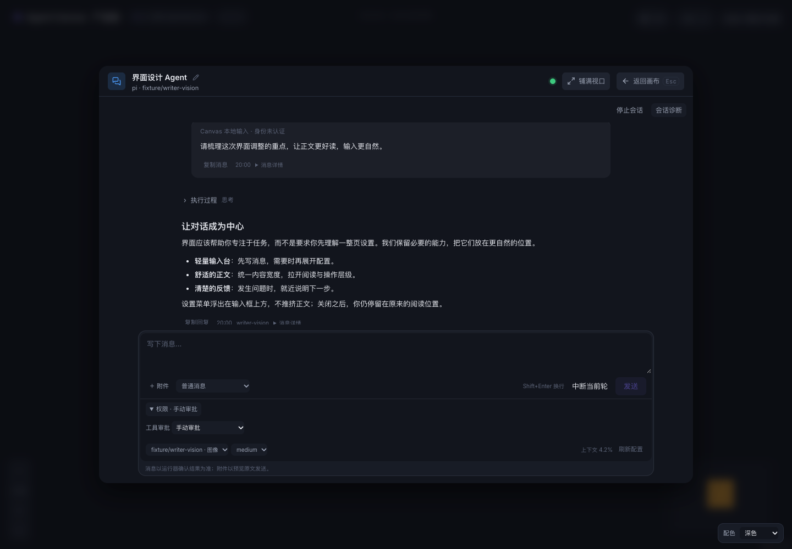 | 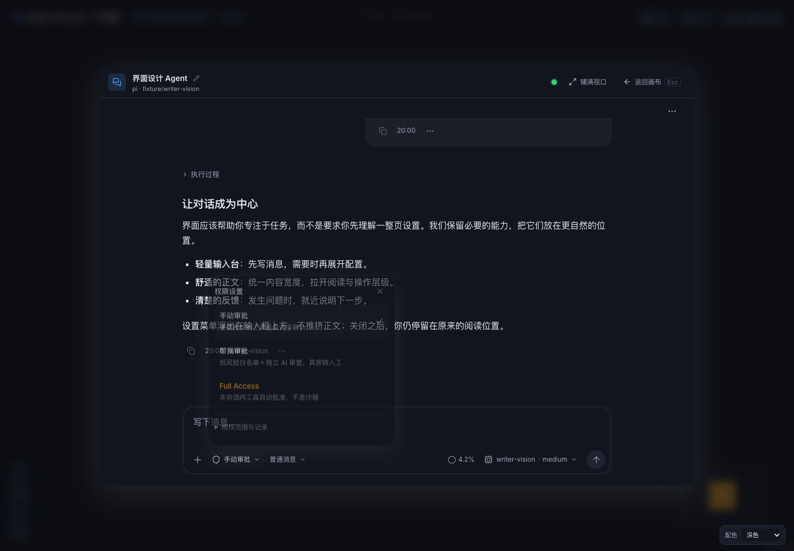 |

其他截图：[执行配置](chat-ui-polish-evidence/after-model.png)、[390px](chat-ui-polish-evidence/after-floating-390x844.png)、[短窗口](chat-ui-polish-evidence/after-floating-900x540.png)、[运行器中断](chat-ui-polish-evidence/after-interrupted.png)。状态矩阵与菜单截图见证据目录中的 `state-*`、`menu-*` 文件。

## 按批准计划验收

| 标准 | 结果 | 观察依据 |
|---|---|---|
| 标准输入台 112–136px，无第二层配置表单 | 通过 | 实测 122px；DOM 结构与 `chat-polish.spec.ts` |
| 权限/模型/上下文展开，正文/输入边界变化 ≤2px | 通过 | 浏览器逐项检查 x/y/width/height；权限/模型测量变化 0px |
| 正文与输入列对齐、独立节点密度 | 通过 | 16px/27.2px、列宽 ≤780px、边缘偏差 ≤2px；节点样式独立 |
| 节点/浮层/全屏菜单不裁剪，关闭可点 | 通过 | 矩形在视口内、`elementFromPoint` 命中关闭/选项/发送/主题控件 |
| 空闲无禁用中断，运行中待发与中断独立 | 通过 | 两种状态均有浏览器断言，390px 忙态无横向溢出 |
| 键盘、焦点、安全确认、Esc、中文 IME | 通过 | 箭头导航、取消默认焦点、确认无提前请求、分层 Esc 与 composition 回归 |
| 同数据同窗口前后对照 | 已保存 | 上方 6 组基础截图＋权限展开，固定 fixture 文案/身份/模型/时间 |
| 状态矩阵 | 自动化通过 | 就绪、草稿、运行、审批、Full Access、停止/中断、配置失败、队列暂停/未知、附件缺失；断线保留草稿由既有用例覆盖 |
| 响应式与窗口状态保持 | 通过 | 1440×1000、900×800、390×844、900×540；同 textarea/carrier、草稿、折叠与阅读锚点保持 |
| 既有功能与安全边界 | 通过 | 全量单测/浏览器；审批/精确授权、配置回读、队列幂等、附件校验、主题、脱敏、窗口化及 herdr fixture |
| 开发/生产深路由与真实 e/Pi 交互 | 通过 | 新独立实例实际回读与变更、队列编辑/刷新/恢复/消费、同 native 停止恢复 |
| 人工目视质量审查 | **未完成** | 内置浏览器不可见；本机 Orca GUI runtime 不可用。未用功能通过冒充视觉达标 |

普通文字/工具栏对比度自动检查 ≥4.5:1，主要专注工具栏目标高度 ≥32px；触控布局采用更宽松目标。未将装饰图形、禁用控件或任意用户内容算进可读性承诺。

## 检查日志与证据分类

| 检查 | 结果 / 日志 |
|---|---|
| `npm run lint` | [通过](chat-ui-polish-evidence/final-lint.log) |
| `npm test` | [92/92](chat-ui-polish-evidence/final-unit.log)，本轮新增 3 项状态归并单测 |
| `npm run build:api` | [通过](chat-ui-polish-evidence/final-api-build.log) |
| `npm run build` | [通过](chat-ui-polish-evidence/final-ui-build.log)，现存 bundle/Browserslist 警告保留 |
| 开发全套含 real | [34/34](chat-ui-polish-evidence/browser-dev-full.log) |
| 开发 fixture 全套（收尾前） | [33 passed / 1 real skipped](chat-ui-polish-evidence/browser-dev-final.log) |
| 最终开发 UI/UX 专项 | [8/8](chat-ui-polish-evidence/browser-dev-polish-final.log) |
| 最终生产全套含 real | [36/36](chat-ui-polish-evidence/browser-production-final.log)：35 fixture＋1 real |
| 菜单切换与嵌套确认稳定性 | [各 5 次，共 10 次通过](chat-ui-polish-evidence/menu-stability.log) |
| 附件交互稳定性 | [连续 3 次通过](chat-ui-polish-evidence/attachments-stability.log) |
| `git diff --check` | [通过](chat-ui-polish-evidence/diff-check.txt) |
| 工作区边界核对 | [完整性记录](chat-ui-polish-evidence/integrity.json)：原仓库 204 文件与清单未变；后端/runtime 未改 |

**真实证据：**[开发交互](chat-ui-polish-evidence/real-dev-results.json)、[生产交互](chat-ui-polish-evidence/real-production-results.json)、[最终真实页面](chat-ui-polish-evidence/final-real-surface.json)。

- native `1882f186-7671-4fbb-9dc7-4c26a7d8b9ca`、AgentSession `as:5a0582ef10a2e31e0a3c03928705ff58` 在配置和恢复后保持。
- 从新配置浮层将 thinking 从 medium 改为 minimal；同 provider `gpt-6-astra → gpt-6.1-sol`；确认后恢复 astra/medium。真实回读，不是仅选择器变值。
- 真实待发项在界面编辑，刷新仍暂停，点击恢复待发后两项消费；第二项提交晚于第一项的 e 消费确认，两条实际回复 ID 不同。
- 停止/恢复由新的会话菜单与就近恢复入口操作，草稿未丢，队列回到暂停。
- 最终真实页面另保存节点、浮层、全屏浅/深色，以及配置菜单截图；此截图步骤未额外发送模型消息。

本轮没有再次声称进行了所有真实工具命令测试；现有工具审批/精确授权/中断协议由原单测和 UI fixture 回归，真实基本对话/配置/待发/恢复则实际重新执行。`real-multi.mjs` 的发送方式入口同步更新，脚本本身未在本轮重新运行。

## 运行与重复验证

在授权 worktree 的 `app` 目录：

```bash
npm run lint
npm test
npm run build:api
npm run build
npm run test:e2e  # 真实模型默认跳过

# 只对明确的隔离实例启用真实模型验收，会消耗已有模型额度：
CANVAS_REAL_E2E=1 CANVAS_TEST_URL=http://127.0.0.1:3329 npm run test:e2e
# 只跑本轮 UI/UX 矩阵：
CANVAS_TEST_URL=http://127.0.0.1:3329 npm run test:e2e -- chat-polish.spec.ts
```

独立开发使用 `CANVAS_PROJECT_ROOT`、`CANVAS_DATA_DIR`、`API_PORT`、`CANVAS_UI_PORT`；生产构建后 `npm run start:e` 在 API 端口提供页面。开发与生产不可同时写同一数据目录。

## 实现边界

主要改动：`Composer`、`ChatPopover/ChatConfirm`、权限/配置/附件/队列组件、`SessionNotice`、正文操作区、局部 CSS、专注 Esc 与画布裁剪保护。没有改 e/Pi runtime、API、队列状态机、附件内容验证、审批策略或全局默认；没有引入依赖、搬运参考产品源码/资产，或添加右侧工作台/语音/历史编辑/调度。

原有未提交变更、协作演示和批准功能保留，无自动 commit/push/清理历史。无法目视审查是本轮剩余验收限制，不以“高级感”“像素级复刻”或主观评分假装已证实。


## 待恢复状态与节点密度修正

针对用户实际截图中的“会话中断 / 运行器暂不可用 / 配置未就绪”组合，本次仅调整前端展示与交互说明，不改服务端生命周期、不自动恢复真实会话。

- 无运行器错误和降级证据的 `interrupted` 显示中性 **待恢复 / 会话尚未恢复**，不把未知原因说成崩溃，也不据此编造重启原因。真实 `failed`、运行器错误或降级仍为告警，诊断可就近打开。
- 旧快照里的 running 轮次不当成当前执行，待恢复不展示无效中断按钮；独立的审批与未知操作仍保留。
- 节点、缩略卡、专注标题和输入台统一标注 **上次使用** 的模型；只有在线就绪且配置回读确认后才称为当前模型。无上下文数据不常驻空圆圈/横杠，而是在配置详情说明。
- 恢复条仅突出恢复操作，诊断仍可从会话菜单打开。输入区采用更紧凑的节点尺寸，不改变专注正文密度。
- 未恢复时普通提交叫 **存入待发**，明确说明“仅保存到暂停队列；恢复会话并明确恢复待发后才会执行”。测试确认请求 `authorize:false`，刷新也不调用 messages/resume。

### 实测与检查

对用户同一真实节点、同一 100% 缩放作只读采样：恢复提示从 **89px → 55.8px**，节点输入台从 **148px → 124px**。采样浏览器拦截全部非 GET/HEAD API 请求，记录为 0 写请求、0 页面错误。真实用户历史截图只留在会话 scratch，不复制进仓库；下列仓库图片均为合成 fixture。

| 浅色节点 | 深色节点 |
|---|---|
| 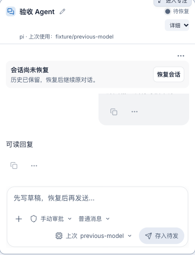 | 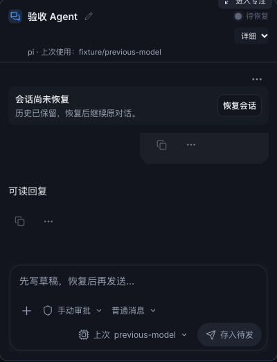 |

[专注态](chat-ui-polish-evidence/recovery/recovery-focus.png) · [真实故障 fixture 仍告警](chat-ui-polish-evidence/recovery/actual-fault.png)

- `npm run lint`（含架构 wiki 校验）、API build、UI build、`git diff --check` 通过。
- 单测 **105/105**，包括新增 5 项恢复/故障/历史模型语义测试。
- 全套浏览器 **40 passed / 1 real-model skipped**，新增 4 项恢复 UI 回归。真实模型用例本轮未执行，不用 fixture 冒充真实消费结果。
- 内置浏览器已可用，本次直接查看了真实浅色节点、配置浮层、深色专注截图；不是只运行几何断言。未点击恢复、入队或发送，真实会话仍未恢复。
- 保留本轮开始时其他工作的目录/测试迁移、后端和文档变更；未用旧文件覆盖。本次仅同步受影响架构模块页及其派生地图。

日志与测量见 [recovery/](chat-ui-polish-evidence/recovery/)。当前日常开发服务 5199 已热加载前端修改，3319 后端未重启。刷新现有页面即可看到修正；真正继续会话仍需要用户明确点击“恢复会话”。


## 紧凑标题与信息去重

本次根据用户截图做三项减法，而不是新增运行能力：

1. **单行标题栏**：昵称、主状态、必要的“恢复会话”和会话菜单同组。卡片视图选择移入会话菜单并显示完整标签；缩略、详细、自动偏好继续独立持久化。
2. **普通恢复不挡正文**：待恢复或正常停止直接从标题栏恢复，不再重复正文通知卡。恢复与恢复待发仍是独立显式操作；真实故障、审批、离线和未知动作的提示保留。
3. **模型信息分工**：详细节点和专注标题不再重复 provider/model；输入台显示当前或上次配置，历史消息实际使用的模型仍保留在“消息详情”与原始元数据中。消息尾部默认只显示复制、时间和详情。

输入框默认文案简化为“写下消息…”，但“存入待发”按钮及有草稿时的暂停说明仍明确，不用发送箭头掩盖队列语义。真正的发送方式、e/Pi 生命周期、配置回读、审批和内容传输协议没有改动。

### 同一真实节点的 100% 缩放测量

| 指标 | 改前 | 改后 |
|---|---:|---:|
| 标题区高度 | 92px | 53px |
| 正文滚动区距卡片顶部 | 191.8px | 59px |
| 正文可视高度 | 176.2px | 270px |
| 整张卡片高度 | 522px | 483px |

这次不是仅把卡片缩小：正文实际可视空间增加约 94px，并提前进入视线。输入台仍固定在底部，不为了消灭空白让输入位置随短消息跳动。

测量时浏览器拦截全部非 GET API 请求：0 写请求、0 页面错误。真实历史截图只在 scratch 保存；文档中的以下截图为明确的合成 fixture。

| 浅色节点 | 深色节点 |
|---|---|
| 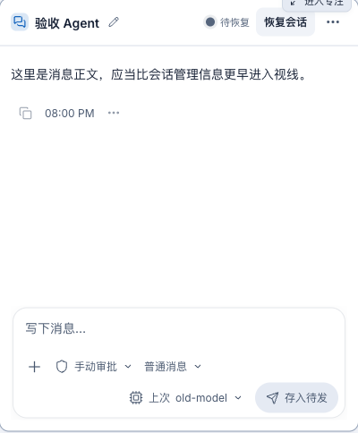 | 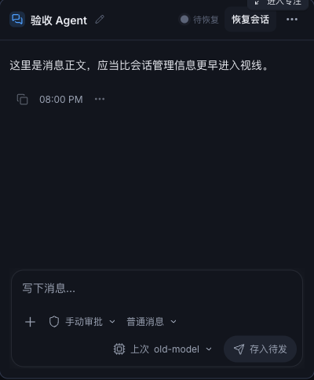 |

[900px 专注态](chat-ui-polish-evidence/header/header-focus-900.png) · [390px 专注态](chat-ui-polish-evidence/header/header-focus-390.png)

### 检查与边界

- 新增 4 项标题栏浏览器回归，覆盖菜单内卡片视图、显示偏好持久化、诊断焦点返回、模型详情、实际故障保留、窄屏命中区域及草稿/DOM 不变。
- 全套浏览器 **44 passed / 1 real-model skipped**；单测 **105/105**。lint（含架构校验）、API/UI 构建、`git diff --check` 通过。
- 内置浏览器直接查看了真实节点、菜单和专注窗口；菜单标签换行问题在目视检查中发现并修正。
- 没有恢复真实用户会话、没有发送消息、没有重启 API，也未修改后端/runtime。保留其他工作已有变更，不自动提交。
- 共享 `NodeShell` / `FocusOverlay` 的紧凑头部是可选能力，herdr/原型默认行为不变；既有 herdr fixture 回归通过。

本轮日志、前后测量与截图位于 [header/](chat-ui-polish-evidence/header/)。刷新现有 5199 页面即可试用这一版。


## 图标权限、自动发送与统一状态球

按用户最新需求，输入台不再让用户常驻管理多个模式：

- **权限图标**：手动审批是普通盾牌，辅助审批是带勾盾牌，Full Access 是警示盾牌。入口只显示图标；悬停、键盘焦点与菜单解释当前模式，菜单中展示三种图标、说明和选中态。Full Access 保留高风险色调、可访问说明和显式风险确认，辅助模式仍显式选择独立审查模型。
- **自动投递**：普通提交固定为 nextTurn。空闲且能力有效时发送新消息；运行/等待审批时加入 Canvas 可编辑队列。已有待发或未确认项不越队；未恢复或停止时只存入暂停队列。提交瞬间重新读取最新状态，不依赖输入开始时的状态。旧的 Steer/Follow-up 偏好不再生效。
- **队列快捷操作**：摘要直接提供首条待发的编辑与立即发送。忙时立即发送经明确 Steer 确认，不中断当前轮；已提交和未知项仍不可伪装成可编辑/撤回。
- **统一状态球**：右上只有一个主指示。正常就绪/运行中，有真实且有效的当前上下文数据时显示环与百分比；点击查看 tokens、容量和采样时间。错误、配置未确认及未知派发优先显示红色状态，移除旧百分比；待恢复、离线、审批与无数据状态不编造用量。输入台不再重复展示上下文控件。

这不是把重试自动化：结果不明时仍保留草稿和原 intent，不自动再发；如果运行状态变化会使同一未确认提交从 messages 改成 queue（或反向），会阻止改道。旧版缺少目的通道记录的未确认提交要求先核实，避免隐藏的 Steer/Follow-up 被当成新消息重复派发。

### 实际观察与截图

当前日常会话只读采样得到 `78,933 / 500,000 tokens`，运行器 `contextUsage.percent=15.7866`，标题球显示 **15.8%**。节点输入台实测 **90px**，左右工具栏中心线差 **0px**。本次采样拦截写 API，记录 0 写请求与 0 页面错误；没有为展示用量恢复会话或发送提示词。真实对话截图只保留于 scratch，不复制用户历史到仓库。

下图中的 **51% 是明确的协议 fixture**，用来验证环形绘制、主题与异常切换，不代表真实模型用量：

| 正常用量（fixture） | 异常优先（fixture） |
|---|---|
| 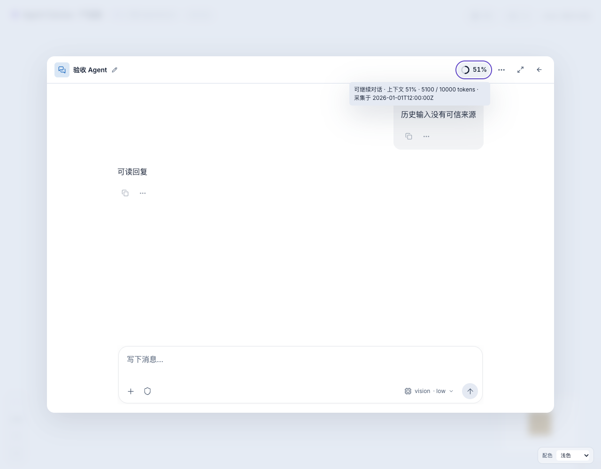 | 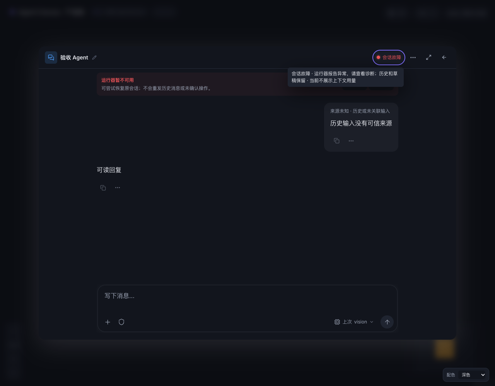 |

[三种权限图标](chat-ui-polish-evidence/automatic/permission-icons.png) · [自动排队与快捷操作](chat-ui-polish-evidence/automatic/automatic-queue.png) · [390px 单行工具栏](chat-ui-polish-evidence/automatic/simple-toolbar-390.png)

### 验证

- 111/111 单测通过；50 项浏览器用例通过，1 项真实模型用例默认跳过。
- lint（含架构 wiki 校验）、API/UI build、`git diff --check` 通过。
- 新增覆盖：自动路由与运行状态切换、旧模式偏好迁移、未知意图不改道、单球 context/error 切换、无效/跨 native 数据拒绝、三种图标、待发快捷编辑和 Steer 确认、窄屏单行布局。
- 原有 Enter/IME/粘贴/晚回执、队列 CAS/幂等、附件、审批、诊断、主题、窗口与 herdr fixture 保留并回归。
- 真实后台状态与用量只读核对；本轮自动发送与 Steer 操作通过 fixture 验证，没有对用户任务进行模型调用。Follow-up 后端 API 兼容保留；opt-in `real-multi.mjs` 已按新 UI 调整 Steer 入口、将 Follow-up 作为 API 回归，本轮未运行该脚本。

日志、截图与只读采样记录位于 [automatic/](chat-ui-polish-evidence/automatic/)。刷新现有 5199 页面即可使用；后端/runtime 和全局模型设置没有修改，日常服务未重启。


## 模型与推理两层选择

借鉴参考图的交互层级，而非复制模型名称、Ultra 标签或装饰资产。输入台保持一个“模型名称＋推理强度”摘要；真实模型名称优先使用目录提供的 name，原始 provider/id 可在模型列表和配置详情查看。

### 使用

- 点击摘要打开**推理强度**面板，当前档位为主视觉；点击面板中的模型名进入第二层**选择模型**，不是再叠一个弹窗。
- 滑条按运行器提供的离散档位排列。拖动仅预览，松开后提交一次；方向键预选、Enter 或临时“应用”按钮提交，Escape 取消未提交预览。
- 外部摘要在回读前保持原确认值；执行中、离线、只读或有未确认操作时可查看但不能修改。
- 模型列表按真实 provider 分组，可搜索名称和 ID；当前勾选来自已确认配置，不随点击提前变成成功。跨 provider 继续需要明确确认。
- 选完模型回到推理面板，并重新读取实际支持的档位。运行器调整了级别会显示说明；不自动沿用不支持的档位，也不默认最高档。
- 单一档位不画可拖滑条；没有可调列表或当前档位无法映射时明确说明，允许重新读取。
- 配置详情展示原生档位、模型与回读时间。重新读取不是“恢复默认”，不修改 Pi 全局设置。

显示名对应明确的原生值：off/关闭、minimal/最低、low/低、medium/中、high/高、xhigh/更高、max/最高；未知值原样显示。不把参考产品的 Ultra 假定为 max 或 xhigh，也不提供未实现的快捷键、快速模式或重置按钮。

### 预览、安全与焦点

预览绑定 native、模型、revision 及可用档位列表。确认跨 provider 或拖动期间若配置已变化，拒绝旧预览，不把它提交到另一模型。请求期间阻止重复提交；HTTP 成功但没有一致回读也不会显示成功。

Escape 按确认框 → 配置详情/模型列表 → 推理面板 → 全屏/浮层顺序处理；中文 IME 期间不误提交或退出。切换二级页面保持同一弹层，不挤动输入台或正文，草稿与聊天 DOM 保持。

模型、状态和权限入口的 hover 提示现在是简短动作/模式说明，完整信息只在点击弹层。三者使用同样的 tooltip 样式，去掉重复原生 title；点击打开时隐藏 hover，不再同时出现两份相同内容。

### 实际验证

独立端口 3330/5211、独立 scratch 项目/数据，没有更改日常用户会话的模型或审批设置。

1. 已有 opt-in 主画布真实两轮对话、刷新与原 native 恢复通过。
2. 新面板的 keyboard 预览期间，Pi 仍为 medium；Enter 后实际回读为 minimal。
3. 同 provider 从 gpt-6-astra 切到 gpt-6.1-sol，运行器实际将 thinking 调整为 medium，面板据此重建。最后恢复 astra/medium。
4. 配置操作前后 native/AgentSession ID 与消息数量保持；只停止本轮测试会话。没有用界面选择结果或 HTTP 200 代替运行器回读。

记录：[真实配置结果](chat-ui-polish-evidence/reasoning/real-picker.json)、[真实对话冒烟](chat-ui-polish-evidence/reasoning/real-smoke.log)。

| 真实独立会话·推理面板 | 真实独立会话·模型列表 |
|---|---|
| 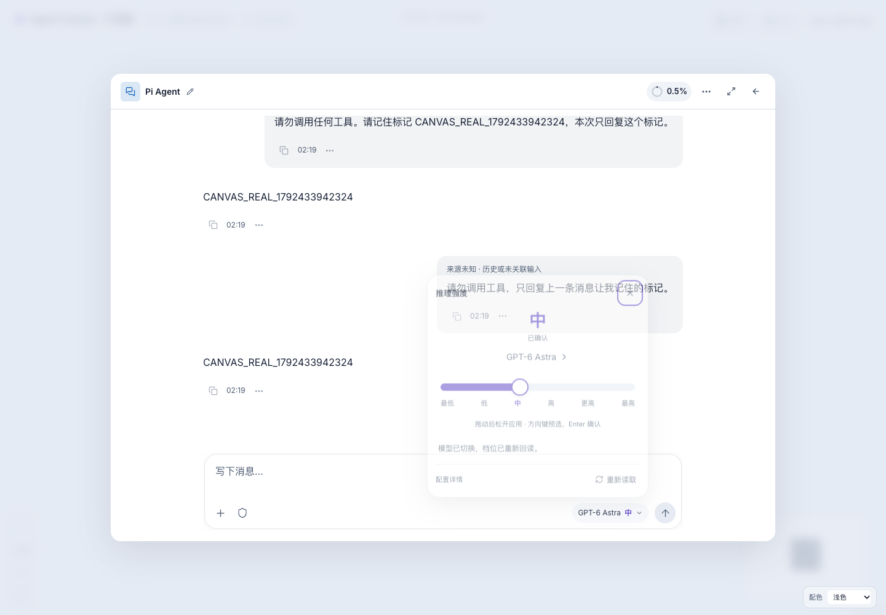 | 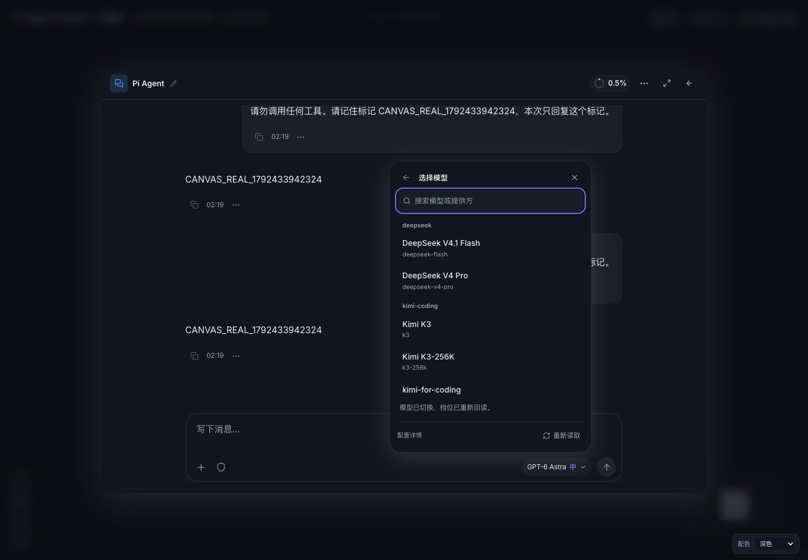 |

[深色推理面板](chat-ui-polish-evidence/reasoning/real-reasoning-dark.png) · [390px fixture](chat-ui-polish-evidence/reasoning/reasoning-390x844.png) · [单一档位 fixture](chat-ui-polish-evidence/reasoning/fixed-reasoning.png)

- lint（含架构校验）、API/UI build、`git diff --check` 通过。
- 单测 **115/115**；全套浏览器 **58/58**（57 fixture＋1 opt-in real）。另有独立真实配置脚本，证据与 fixture 分开。
- 本轮新增 4 项纯展示/配置基准单测、7 项推理选择器浏览器用例：拖动/键盘只提交一次、回读前摘要保持、二级搜索/选中、busy/无回读拒绝、跨 provider/旧版本确认拒绝、hover 去重、窄屏/短窗口/焦点、旧预览不套用新配置。
- 已直接目视实际主画布面板和模型列表，修正默认说明过多的问题；没有声明像素复刻参考产品。

当前日常前端 5199 已热加载本轮 UI。后端/runtime 未修改、日常服务未重启，测试配置变更仅发生在本轮独立会话；无自动 commit/push。


## 全局卡片视图

“配色”旁新增 **卡片：自动 / 缩略 / 详细**，支持本浏览器同源所有主画布共享默认值，新增卡片默认跟随。

- 单卡菜单新增“跟随全局（当前值）”；单卡明确选自动、缩略或详细时优先于全局。
- 全局选择器旁的设置入口显示本画布保存的单卡覆盖数量；“本画布全部跟随全局”是显式重置，仅清除本工作区的显示覆盖。
- 专注始终优先，切全局视图不会退出专注或重建当前聊天；返回画布后按最终偏好显示。
- 全局默认和单卡覆盖刷新后保留，并在同源标签页同步。跨工作区只共享全局默认，不共享 node 覆盖。
- 旧 v1 固定缩略/详细设置保留；新 v2 区分显式自动与继承。存储受限时降级为内存行为，不让按钮失效。
- 仅影响主画布呈现，不调用会话控制 API，不修改模型、审批、队列或运行器；独立原型页面不受全局默认影响。

实现见 `GlobalCardViewControl.tsx`、`shared/card-view-preferences.ts` 与 `ViewModeManager.ts`。入口挂到 `App` 的配色容器，在浮层和全屏仍可访问；离开主画布时卸载卡片入口，不留下失效控件。

### 验证

- 120/120 单测；63 浏览器用例通过，1 项真实模型用例默认跳过。
- 新增 5 项单测与 6 项浏览器用例：继承/覆盖优先级、显式自动、旧记录迁移、不复活已清除覆盖、新节点、跨工作区、同源及同工作区双标签页、受限存储、全屏/窄屏可访问、同 DOM/草稿/阅读锚点保持。
- fixture 中监测 API 写请求为 0；只变显示，不运行模型。原有卡片、审批、主题、诊断、聊天与 herdr 兼容回归通过。
- lint（含架构校验）、API/UI build、`git diff --check` 通过。
- 已在真实页面目视确认“配色”旁入口和设置面板；没有替用户更改实际全局或单卡偏好，也没有启停 Agent。

[全局与单卡覆盖（fixture）](chat-ui-polish-evidence/global-view/global-with-local-override.png) · [390px 全屏全局入口（fixture）](chat-ui-polish-evidence/global-view/global-control-full-mobile.png)

证据保存在 [global-view/](chat-ui-polish-evidence/global-view/)。显示规则详见 [卡片视图与审批](card-views-and-approvals.md)。


## 名字引用与真实跨 Agent 协作

昵称修改旁新增复制名字/hash；输入 `@` 列出同画布其他 Agent。支持键盘、鼠标、中文输入法和光标片段替换；选择只改草稿，不发送、不 Steer。

Pi 现在显式加载 Canvas 的四个协作工具：列同伴、读取完成文本/发布产物、发布文本、向另一 Agent 的现有队列发消息。全部经过 e 审批与真实调用身份核对；暂停/停止/重启不自动唤醒，不重试未知投递。通信记录投影为独立连线，读/发分道、可点击核对内容及实际状态。

验证：137 单测通过、70 浏览器通过/1 原有 opt-in 跳过、lint+架构+API/UI 构建通过、11 文档工具测试通过；两轮真实双 Agent 完整闭环通过，HTTP/WS 另核验拒绝审批、暂停入队、明确恢复、可信来源重放与最新结果读取。真实画布、详情和补全均已目视检查。修复了透明 SVG 热区遮挡标签、读/发双边重叠，以及重放消息数组顺序和历史来源关联的问题。

详见[使用与权限边界](canvas-collaboration.md)和[证据目录](chat-ui-polish-evidence/collaboration/)。前端可热加载；日常 API/既有 Pi 未重启，实际工具需安全重载 API 后明确恢复会话。原工作区、ADE、Pi 安装、全局默认及认证未修改。


## 协作版本包与加载确认（2026-10-20）

从 Herdr 借鉴的是独立 Skill、公共契约和加载状态分层，而不是终端注入或弱化审批。当前 Skill、协议、扩展均为版本 1；资源存在不等于运行时就绪，必须核验版本/摘要、真实 Skill 发现、4 个工具与系统指令绑定。

加载状态进入原有状态球详情，没有新增常驻工具栏。旧 API、漂移、超时或断线只停用协作；草稿和普通聊天保留。结构化错误明确禁止未知投递自动重试，消息消费仍不等于任务完成。

全量 154 单测、74 浏览器夹具通过 / 1 opt-in 跳过；API/UI 构建、ESLint 通过。最终真实双 Agent 发布/读取/发送/消费与回复闭环通过，独立会话已停止。当前证据、运行边界与后续文档门禁见 [版本包验收](chat-ui-polish-evidence/collaboration-package/README.md)。历史阶段的计数和目视限制不改写成本轮结论。


## 工具执行层级收拢（2026-10-20）

针对“整页只有工具入口、时间戳和空白”的反馈，修复两层问题：上游内部 turn 按工具步骤拆分导致一条条空助手段，以及纯工具段仍沿用正文间距/页脚。

- 默认是紧凑的执行摘要：工具数量、工具类型与真实状态；不显示每次调用的时间戳，不因正在运行就自动打开整组。
- 第一层展开显示工具/思考列表，第二层点开单工具才呈现输入、输出、历史审批与请求时间；运行/消息级技术证据在“执行详情”里。
- 只合并连续、同 run（或双方都无 run）的纯执行展示。正文、用户插话、消息错误、孤立活动与不同 run 都保留边界；原始参数、结果、审批和 run/turn 身份不改写、不重关联。
- 长链首次展开显示最近 20 步，支持继续加载更早步骤。打开的阅读窗口不被新步骤挤走；“查看新增步骤”由用户点击，不抢焦点或自动滚动到另一条工具。
- 失败/拒绝/未知在收起摘要可见；待审批卡独立保留。不会因为折叠而自动批准、隐藏请求或声称执行成功。

### 验证与截图

173 项单测、79 项浏览器 fixture（1 个 opt-in 真实 e 用例跳过）通过；API/UI 构建及 ESLint 通过。覆盖 8 个内部 turn → 1 个执行组、45 步长链的 20 步渲染窗口、流式追加/展开状态/草稿 DOM、390px 无横向溢出与审批可操作性。没有为展示测试调用真实模型或执行工具。

[收起状态](chat-ui-polish-evidence/tool-hierarchy/collapsed-desktop.png) · [工具详情展开](chat-ui-polish-evidence/tool-hierarchy/expanded-desktop.png) · [390px 失败与审批](chat-ui-polish-evidence/tool-hierarchy/mobile-failure-approval.png)。这些均为合成 fixture 截图；收起桌面图已在内置浏览器目视确认，切换图片后面板报告 `browser guest is not available`，因此其余两图只声明自动截图/布局断言，不冒充目视验收。

完整验收见 [证据记录](chat-ui-polish-evidence/tool-hierarchy/README.md)。本次是前端展示改动，Vite 可热更新，不要求重启日常 API；未发送真实会话消息、处理审批或更改权限，也未提交/推送。


### 混合消息的二次收拢

第一版只合并整个条目均为工具/思考的情况，所以“工具组 → 下一条消息的思考＋正文＋单工具 → 后续工具组 → 思考＋回答”仍会出现五个执行入口，并把混合消息的时间戳留在工具后面。

现在先按内容边界生成显示片段，再合并同 run 中相邻的执行片段。上述结构收成两个执行入口，中间正文仍按原顺序显示。纯执行组没有页脚；原消息的最后一段正文负责时间/复制/详情，复制内容仍是该消息完整正文。用户插话、错误、未关联活动与不同 run 仍是边界。

收起摘要只保留名称、工具数与就近状态，工具类型统计和思考段数移入展开层；没有工具时用“思考过程”，不再默认显示“执行过程 1 段思考”。按钮与组间距进一步收紧，但输入/输出、失败提示与待审批入口未删除。

截图场景测试包含 24 个工具、混合消息中的 1 个工具、后续 69 个工具及下一条消息的思考：实际显示 **24 / 70 两个执行组**。流式追加回答不卸载已展开的工具；复制回归确认前后正文都保留。桌面与 390px 新截图均已在内置浏览器目视确认，见 [二次收拢证据](chat-ui-polish-evidence/tool-hierarchy-v2/README.md)。最终全量检查写入该目录的 `verification.json`。


### 执行中的短句

收起行现在在原位置给出一句本地、确定性的进度说明：读取/修改文件、搜索、常见测试命令与 Canvas 受管操作会显示对应动作；工具完成但模型仍在思考时显示“已…，正在梳理结果”。待批准、失败、未确认或会话未就绪优先显示真实状态，不会继续写“正在思考”。

说明不使用模型，不引用思考或工具输出；路径只显示受控短文件名，私密路径和敏感参数不进入标题。复杂 shell 只写“执行命令”，命令结束不宣称测试通过或任务成功，Canvas 入队/派生也不写成已消费/已就绪。短句会在真实状态变化时更新，不触发自动展开、滚动、提交或写操作；桌面与 390px 截图已目视确认。最终检查见 [执行短句证据](chat-ui-polish-evidence/execution-activity-summary/README.md)。


### 空系统消息不再误报失败

会话里出现的空 system 文本或空错误载荷以前会被当成失败展示，造成“本次回复失败”或类似横幅，看起来像网络请求出错。现在只在确实有错误内容时显示失败框；空 system 消息不会生成可见错误。修复后，11 项聊天回归通过，完整单测/构建/lint/文档检查也已通过。真实后端、协作和审批路径未变。
