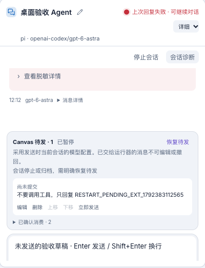
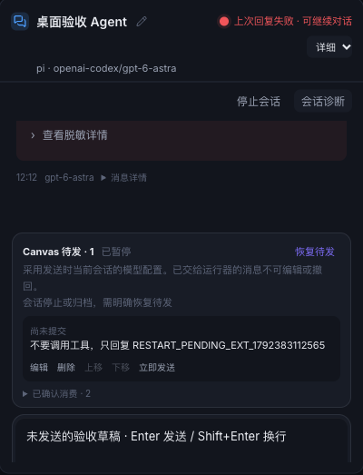
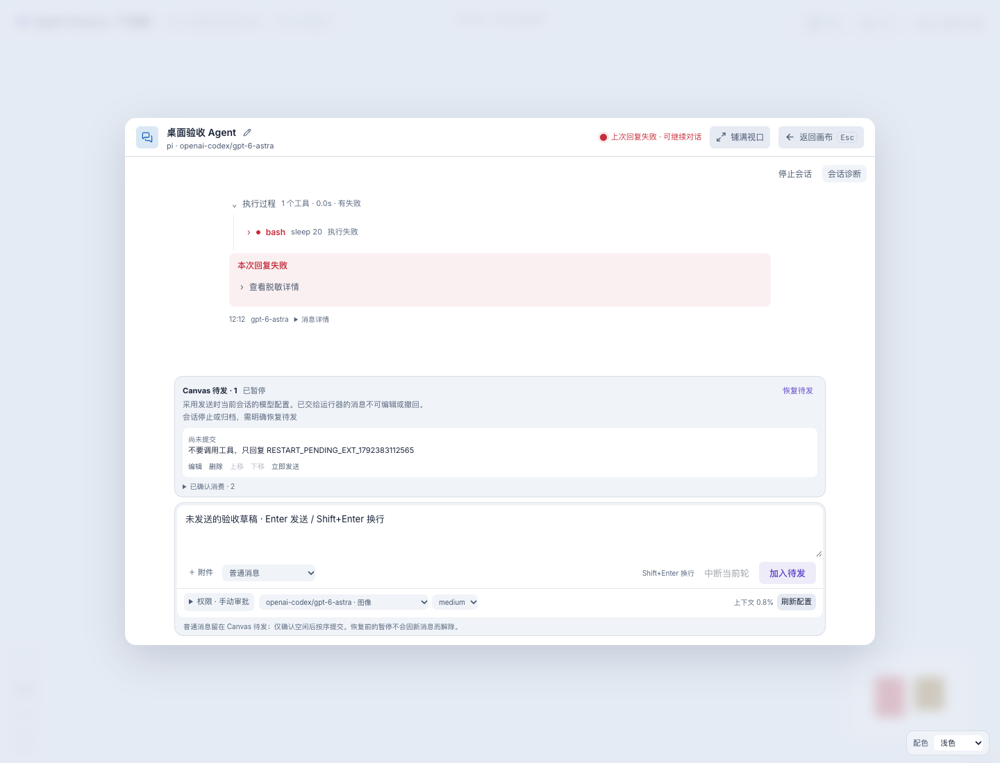
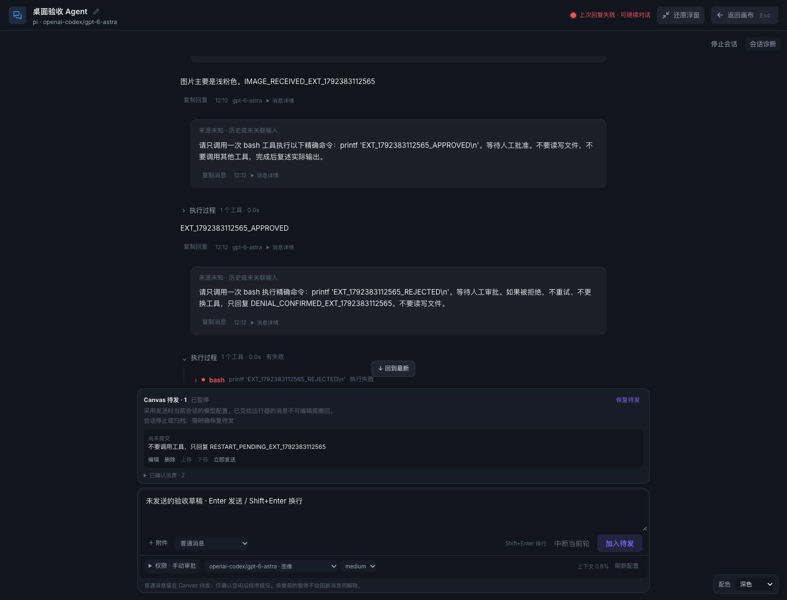
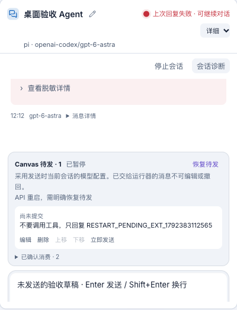
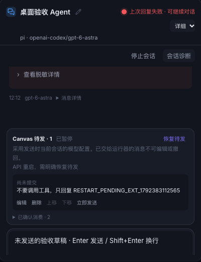
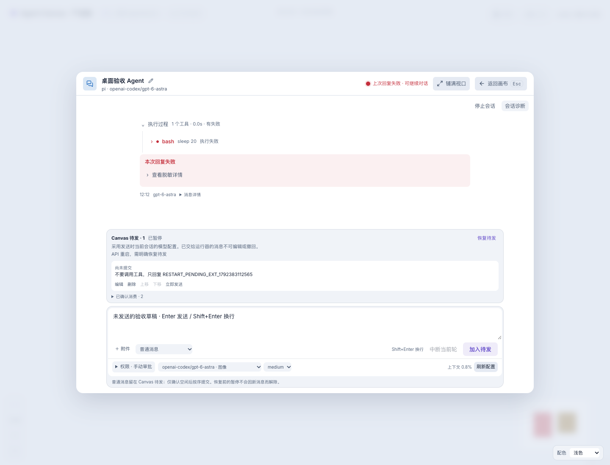
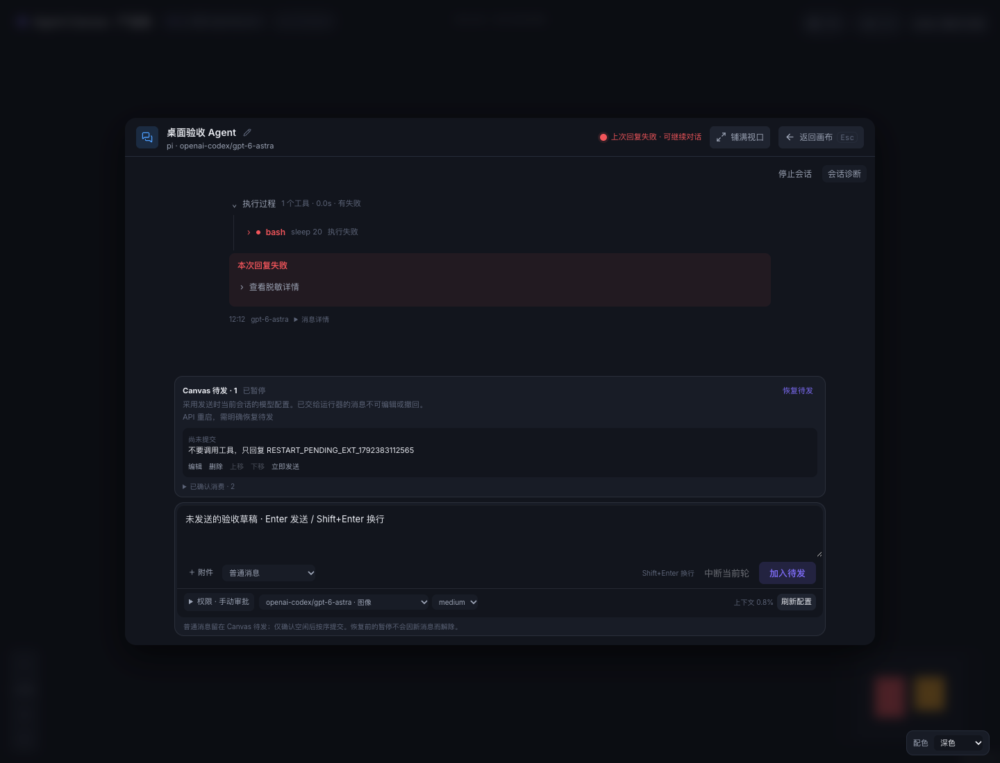
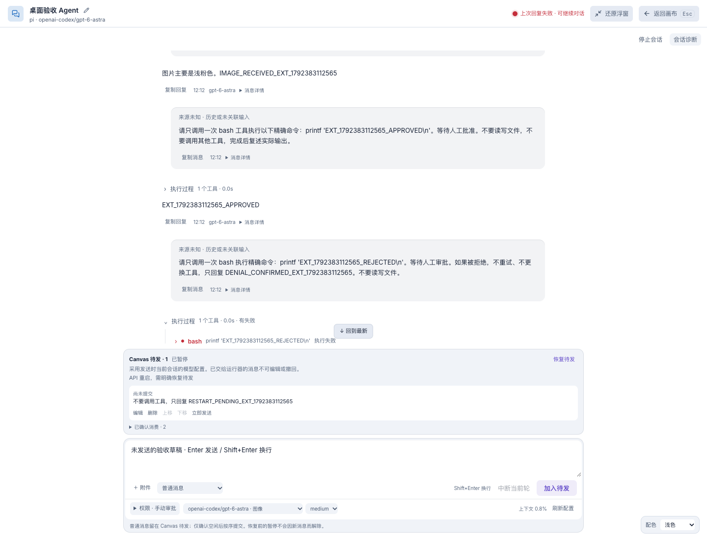
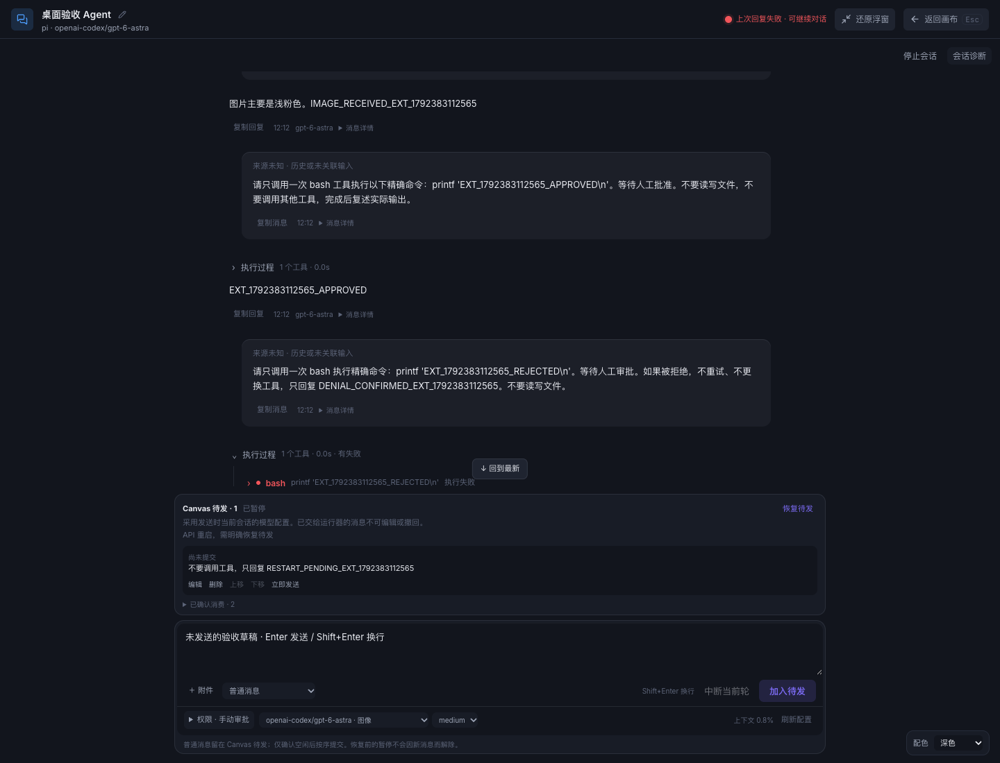

# 桌面级 Agent 聊天体验

> **最新 UI/UX 重构见 [chat-ui-polish.md](chat-ui-polish.md)**：122px 输入台、浮出权限/配置、16px 专注正文、就近恢复、应用内确认；本轮 92 单测、36 浏览器用例通过。截图与几何检查已执行，人工目视通道不可用，未宣称视觉审查通过。下文保留前一阶段的功能合同验收与实现历史；“权限折叠”等旧入口描述以新文档为准。

## 交付状态

2026-10-19，在 `agent-canvas-e / feat/agent-canvas-e` 的既有 `/canvas/:workspaceId` 完成统一聊天输入、真实配置、可编辑待发、附件、身份与浮窗/全视口交互。没有新建替代聊天页或引入另一套 Agent runtime。

**最终检查：lint、89/89 单测、API/UI build、28/28 Playwright（27 fixture + 1 真实 Pi）、`git diff --check` 通过。** 四节点、每节点 500 消息的窗口化用例另连续 5 次通过。开发模式与生产单服务均实际访问深路由并刷新、操作与截图。真实模型、配置、消费、工具和恢复证据与 fixture 分开记录。

本次仅修改授权 e worktree，保留原有未提交内容、协作演示、精确授权、独立审批模型与 herdr 兼容。原 `agent-canvas-poc` 204 个基线文件哈希与文件清单不变；ADE 只读。未执行 commit/push/pull/stash/reset/clean，未修改 Pi 全局默认、认证或系统代理。日常 3319/5199 服务未被重启。

## 如何使用

- **顶部**：点昵称旁编辑入口保存 Agent 昵称；同 Canvas 的重名才有稳定 `@hash`。单个主状态灯支持鼠标悬停和键盘焦点解释，失败、审批和未确认操作有文字。
- **中央**：助手正文没有常驻“助手”标题；工具、思考、审批与真实轮次关联。复制、实际时间、模型与详情在正文尾部。来源缺失显示“来源未知”，本地 Canvas 输入明确“身份未认证”。
- **底部**：待发列表 + 文本/附件 + 发送方式 + 权限 + 当前执行模型/思考/上下文。执行模型与审批审查模型分别配置，权限入口不再占对话顶部。
- **窗口**：默认居中浮层，“铺满视口”只改变尺寸，不重建会话。Esc 依次处理内层菜单/权限/诊断、全屏→浮层、浮层→画布。IME 组合期间不提交或退出。
- **主题**：只有全局“配色”入口，浮层/全屏仍可使用。浅色、深色、跟随系统与同源偏好同步保留。

### 发送与草稿

Enter 提交、Shift+Enter 换行。运行中普通消息显示“加入待发”，明确留在 Canvas 队列；不会自动变为 Steer。Steer/Follow-up 必须显式选择，有效能力才可用。“中断当前轮”与顶部“停止会话”不同。

草稿按 workspace/node/native 隔离，晚到回执只清理相同 revision；继续编辑的新文字/附件不丢失。离线只保留草稿，不会恢复后自动发。拒绝与未知回执保留内容和原 intent，不显示成功。文本草稿在同标签页 sessionStorage 有界保留 24 小时；附件内容仅内存保存，刷新后列出缺失名称并阻止提交，必须重新选择或明确移除缺失标记。

### 真实配置

配置数据由当前 Pi 的 `get_state`、`get_available_models`、`get_available_thinking_levels`、`get_session_stats` 回读。仅开放这些受管命令以及会话内 `set_thinking_level`，不开放任意 RPC。模型切换经 e 的 `agentSession.control.model.switch` 权限、native/revision/basis 校验。

配置与发送互斥；执行/未确认发送期间拒绝不安全的变更。版本冲突、RPC 失败、回读不一致明确报错，不将选择器新值当成功。确认的配置随会话恢复；不写 Pi 全局默认。e 某些 model action 可能仍是 dispatched，配置确认只来自 Pi 实际状态，不伪造该 action 为 applied。

上下文只显示 Pi `contextUsage`，不是累计 token。无有效数据时显示 `—`；悬停用量可查看采集时间及实际 tokens/capacity。模型目录和容量也是实际运行器值，不提供静态假菜单。

### Canvas 待发队列

- 仅 `pending` 项可编辑、删除、上移/下移；服务端持久化 `revision`，变更带稳定 mutation ID，派发带稳定 intent ID。
- UI 区分“尚未提交”“已交给运行器”“结果未知·冻结”和“已确认消费”。不伪装已经派发项可编辑/撤回。
- 经用户授权继续后，只有确认空闲、能力有效、没有前一项未确认消费时才按序发送。消费依据 e 的 exact tuple `applied`，不是 HTTP 202、模型回复数量或时间推测。
- 运行中“立即发送”要确认 Steer；不会中断当前轮。未知结果冻结，无盲重试。
- 停止、归档、API/runtime 重启会暂停。恢复原会话不等于恢复待发，必须再次明确恢复。
- 每项采用**派发时当前会话配置**。不会缓存入队时的模型冒充实际执行配置。
- 容量防护：最多 20 条 pending / 队列约 32 MiB，变更记录有界。历史状态不会悄悄删除或重放。

### 粘贴与附件

超过 2,000 字符的纯文本粘贴成为可展开编辑/移除的内容卡，不写入项目文件。支持显式选择 UTF-8 纯文本、PNG/JPEG/WebP；图片仅在当前模型确认支持图像时可发送。

前后端共用 `app/shared/message-content.mjs`：每条最多 4 个附件，单图 ≤2 MiB，文本附件合计 ≤100 KiB，总请求 ≤12 MiB（HTTP 超限明确 413）。拒绝非法 UTF-8、NUL、路径/URI 额外字段、危险文件名/执行型预览与 MIME/签名不匹配；不读取任意目录或远程资源。

Pi 会把 text 内容块合并，因此发送前以相同规则规范成一个 text 块，保持预览原文、附件名称与 e 精确消费摘要一致。图片在发送前复用当前安装 Pi 的图片处理能力校验：若不能解码，或 Pi 会缩放/转换/省略原图，则拒绝并要求用户调整后重选，不偷偷改变确认内容。图片原字节经 e 内容块传递。

## 实现位置

| 范围 | 主要文件 |
|---|---|
| 身份、昵称、稳定重名后缀 | `SessionIdentity.tsx`、`session-identity.ts`、`session-manager.ts` |
| 稳定窗口与阅读 | `FocusOverlay.tsx`、`chat-ui-store.ts`、`useConversationScroll.ts` |
| 统一输入与操作 | `Composer.tsx`、`RuntimeConfigControl.tsx`、`QueuePanel.tsx`、`AttachmentTray.tsx` |
| 队列状态机/持久化 | `api/e/message-queue.ts`、`session-manager.ts`、`api/routes.ts` |
| 真实配置/内容派发 | `scripts/e-configuration.mjs`、`e-message-preflight.mjs`、`e-runtime-worker.mts` |
| 正文/真实来源/错误隔离 | `project-transcript.ts`、`TurnView.tsx`、`message-metadata.ts`、`presentation-state.ts` |

继续使用 react-markdown 10.1.0、remark-gfm 4.0.1、use-stick-to-bottom 1.1.6、Shiki 3.22.0 和 next-themes 0.4.6（MIT；保留依赖原许可证）。图片检查调用已安装 Pi 的工具模块，不复制其源码。未复制 PI-Desktop/Codex Desktop 源码或资产，未引入 Electron。

## 验收证据索引

证据已随文档保存于 [desktop-chat-evidence/](desktop-chat-evidence/)。原始大日志/本地测试数据仍在本次会话 scratch 的 `desktop-chat/`，未放进日常项目数据目录。

| 代号 | 类型 | 文件/观察结果 |
|---|---|---|
| U | 单元/fixture | [final-unit.log](desktop-chat-evidence/final-unit.log)：89 passed；含身份、配置、队列、附件、来源、中断展示、审批与安全边界 |
| B | 浏览器 fixture + opt-in real | [final-browser-production.log](desktop-chat-evidence/final-browser-production.log)：28 passed，其中仅 `real-e.spec.ts` 调用了真实模型 |
| S | 压力 fixture | [final-browser-stability.log](desktop-chat-evidence/final-browser-stability.log)：4×500 消息、另节点更新不影响当前阅读，连续 5 次通过 |
| C | 真实 Pi 配置 | [runtime-configuration.json](desktop-chat-evidence/runtime-configuration.json)：实际 15 模型；medium→low；同 provider astra→6.1-sol→astra，最终恢复 medium |
| R | 真实两轮与顺序队列 | [real-sorted-replies.json](desktop-chat-evidence/real-sorted-replies.json)、[real-queue.json](desktop-chat-evidence/real-queue.json)：四个不同回复 ID；第二队列项晚于第一项消费才提交 |
| X | 真实扩展回归 | [real-extended-v2-results.json](desktop-chat-evidence/real-extended-v2-results.json)：UTF-8、小 PNG exact applied、printf 批准/拒绝、Steer/Follow-up applied、中断 applied/run cancelled、同 native 恢复 |
| P | 重启暂停/显式恢复 | [restart-before-results.json](desktop-chat-evidence/restart-before-results.json)、[restart-after-results.json](desktop-chat-evidence/restart-after-results.json)：恢复 native 后等待 16 秒仍 pending；明确 resume 后 consumed 并收到对应回复 |
| D | 真实开发/生产页面 | [dev-surface.json](desktop-chat-evidence/dev-surface.json)、[production-surface.json](desktop-chat-evidence/production-surface.json)：深路由刷新、昵称/草稿/队列、相同 DOM、阅读锚点、主题与 Esc；无 pageerror 或错误 JS/CSS 资源 |
| H | 真实 API 拒绝测试 | [http-validation.json](desktop-chat-evidence/http-validation.json)：非法 UTF-8、URI 字段、>12 MiB 均拒绝且未增加运行器动作 |
| G | 静态/边界检查 | `final-lint.log`、`final-api-build.log`、`final-ui-build.log`、`integrity-check.json`、`diff-check.txt` |

真实会话：workspace `ws-b7e48ab2`，node `n-e3f5c689-aaf9-4098-ac9e-63ca0886c65d`，native `f62e2b4d-0460-4f29-a2dc-505b4c06cae8`，AgentSession `as:469d81cdf1cf1454ce1cba690b3ca498`。配置变更、恢复、开发→生产切换后 ID 不变，昵称“桌面验收 Agent”保留。

### 逐条完成标准

以下编号一一对应批准目标的各条验收标准；“满足”指已实现并以列出的观察验证，不表示超出下文列明的运行器边界。

| 条目 | 结论 | 观察证据 |
|---|---|---|
| 1.1 修改昵称、持久化且身份不变 | 满足 | U 昵称 CAS/持久化；B 卡片/缩略/专注编辑；X/P/D 真实恢复/刷新且四元身份不变 |
| 1.2 仅同 Canvas 重名加稳定后缀、确定性碰撞 | 满足 | `session-identity.test.mjs` 6 项；B 改名后兄弟后缀同步消失 |
| 1.3 单一可访问主状态与风险文字 | 满足 | B 单一可见状态灯、focus tooltip、审批/失败/Full Access；未确认动作不伪装成功 |
| 1.4 无重复助手/专注标签、来源不猜测 | 满足 | B 标签/来源断言；U missing source；X 本地输入为未认证来源 |
| 1.5 浮层/全屏稳定会话与 Esc 层级 | 满足 | B 同 DOM/草稿/折叠/锚点/IME；D 真实页面及权限 Esc 回归 |
| 1.6 全局主题唯一且三种主题正常 | 满足 | B theme/identity-window；D 浮层/全屏可访问全局入口 |
| 2.1 Composer 统一与既有审批能力 | 满足 | B 权限从 dock 展开、显式 reviewer/风险确认；U 精确授权与审批引擎回归 |
| 2.2 忙时草稿/普通加入待发/显式 Steer | 满足 | B 请求断言普通消息仅 queue；X 显式 steer/followUp 实际 applied |
| 2.3 Enter/换行/IME/粘贴/晚回执/离线 | 满足 | B 真实浏览器剪贴板多行、IME、断线/刷新与提交期间继续编辑 |
| 2.4 中断当前轮≠停止、配置不重建 | 满足 | B 请求端点区分；X run cancelled、lifecycle ready；C 同 native 配置回读 |
| 2.5 模型/思考真实、并发拒绝与恢复 | 满足 | U 并发/假成功/回读失败；C 实际切换并复原；X/P 保留 confirmed config |
| 2.6 真实 contextUsage/容量/采样时间 | 满足 | U 排除累计 token、无数据不显示百分比；B 采样时间；C 实际 capacity |
| 3.1 输入上方待发项编辑/删除/排序/立即发 | 满足 | B queue 操作与提交前后区分 |
| 3.2 持久化/CAS/幂等不重复派发 | 满足 | U manager mutation/intent 去重、冲突；B 刷新和冲突保留编辑 |
| 3.3 明确授权、空闲与前项消费后顺序发 | 满足 | U 状态机；R 两项真实 applied/提交时序 |
| 3.4 忙时立即发须确认 Steer，不自动中断 | 满足 | B 取消确认不请求、接受带 confirmSteer；X 显式 Steer 未 abort |
| 3.5 已提交不可编辑/撤回、未知冻结 | 满足 | U pending-only/unknown；B submitted 无编辑按钮、unknown 冻结文字 |
| 3.6 重启/停止/归档暂停，恢复不自动执行 | 满足 | U manager/queue + stop/归档同 stop 路径；P 真实服务重启/会话恢复/显式恢复 |
| 3.7 使用派发时当前配置 | 满足 | B 队列说明；U queue 不持有误导性 model；worker 派发读取当前模型 |
| 4.1 长粘贴折叠/预览/编辑/移除、不写文件 | 满足 | B 编辑与原文字节断言；实现仅内存/内容块，无项目文件写入路径 |
| 4.2 UTF-8/图片且真实图像能力与 e 内容块 | 满足 | U/B 类型和能力；X 有效 PNG 原字节出现在真实 user image 块，action applied |
| 4.3 4 个/2 MiB/100 KiB/12 MiB 一致限制 | 满足 | U 精确边界/总量；B 前端报错；H HTTP 413 且没有 runtime dispatch |
| 4.4 非法编码/签名/可执行预览/任意读取拒绝 | 满足 | U/B 恶意输入；H URI 拒绝；安全 Markdown 无远程图片加载 |
| 4.5 确认预览与最终发送一致，刷新不漏附件 | 满足 | B 文本/PNG bytes、缺失阻止发送与重选；X exact tuple applied；Pi 改写预检拒绝 |
| 5.1 正文/过程分层、真实工具数量状态时间 | 满足 | U 投影/时间缺失；B 工具唯一关联与展开；X 真工具/审批记录 |
| 5.2 区分可信来源与缺失来源、不编造 Agent | 满足 | U sourceLabel；B 历史来源未知；X Canvas 本地输入明确未认证 |
| 5.3 无助手重复标题、低噪声元数据与错误区分 | 满足 | B 输出结构；U 真实模型/时间、取消优先；X 中断不冒充成功 |
| 5.4 Markdown/高亮/脱敏/窗口化/会话订阅 | 满足 | B 原主题/诊断/安全回归；S 别节点 15 次更新不改变当前 DOM/阅读 |
| 5.5 不展示未实现的历史/语音/调度按钮 | 满足 | 组件与 B 可访问树中无这些控制；未加入排除功能 |
| 6.1 全部门禁与既有兼容回归 | 满足 | U/B/G；herdr 为 fixture 终端回归，未宣称新增真实 herdr 运行 |
| 6.2 新增可重复测试覆盖指定边界 | 满足 | `desktop-*`、`session-identity`、`identity-window` 与扩展的 chat/主题测试均保存在项目 |
| 6.3 开发/生产深路由、关键交互与六类截图 | 满足 | D；下方 12 张真实页面截图 |
| 6.4 真实两轮/配置/切换/顺序队列/native/重启 | 满足 | C/R/X/P；独立端口和 scratch 数据，无 fixture 替代 |
| 6.5 实际附件、无副作用审批/中断/Steer/Follow-up | 满足 | X 精确 printf/sleep 命令审批，真实消费/结果分别记录 |
| 6.6 文档、运行说明、能力表与真实阻塞说明 | 满足 | 本文、`E_BACKEND.md`、保存的日志/JSON/截图；未以 HTTP 成功冒充消费 |

## 截图（真实会话，不是 fixture）

开发 UI 5206 / API 3326；生产单服务 3327。截图时待发项为暂停、草稿未发送。均使用本机真实 Chrome/Playwright 自动化，**不声称已人工目视审查**；PI-Desktop 内置浏览器因当前会话视图不可见未能打开。

| 模式 | 浅色 | 深色 |
|---|---|---|
| 开发·节点 |  |  |
| 开发·浮层 |  |  |
| 开发·全屏 |  |  |
| 生产·节点 |  |  |
| 生产·浮层 |  |  |
| 生产·全屏 |  |  |

## 重复检查与启动

在授权 worktree 的 `app` 目录，日常配置继续使用忽略的 `.env.e`。生产和开发 API **不能同时写同一数据目录**。更新日常服务前先核对所有会话无运行中任务，再由启动终端正常停止；本次没有替用户重启日常服务。

```bash
npm run lint
npm test
npm run build:api
npm run build
npm run test:e2e                   # fixture，真实模型默认跳过
# 已启动独立验收服务时，显式调用现有真实模型（会消耗额度）：
CANVAS_REAL_E2E=1 CANVAS_TEST_URL=http://127.0.0.1:3327 npm run test:e2e
# 在 worktree 根目录：
git diff --check
```

独立开发验收示例（`TEST_ROOT` 由调用者指定为专用临时目录，不要指向日常数据）：

```bash
mkdir -p "$TEST_ROOT/project" "$TEST_ROOT/data"
CANVAS_PROJECT_ROOT="$TEST_ROOT/project" CANVAS_DATA_DIR="$TEST_ROOT/data" \
  API_PORT=3326 CANVAS_UI_PORT=5206 npm run dev:e
# 确认任务空闲后正常停止上述服务；构建完成再使用同一份测试数据：
CANVAS_PROJECT_ROOT="$TEST_ROOT/project" CANVAS_DATA_DIR="$TEST_ROOT/data" \
  API_PORT=3327 npm run start:e
```

API 新增：`PATCH .../session {title,expectedVersion}`、`POST .../configuration {}`（回读）或带 intent/revision 的配置变更、`POST .../queue`（变更含 mutationId/revision），原 messages 接受附件。详见 `app/api/e/contracts.ts`。

## 已知限制与不作出的承诺

1. **从未产生首个持久化回复的空 Pi 会话**可能没有原生 session 文件。恢复会明确报 `original Pi session file not found; refusing to create an empty replacement`；保留记录，不伪造新身份。真实恢复验收使用已存在原生历史的会话，此限制的旧失败记录也保留在 scratch。未宣称空文件丢失可以恢复。
2. 当前 Pi 0.87.1 的图片处理会受模型尺寸配置影响。即使文件小于 2 MiB，不能原样传递时也会明确拒绝；用户调整尺寸重选。不是所有仅有合法文件头的损坏图片都能解码。真实 PNG 传输成功不等于保证视觉识别准确率。
3. 初次附件验收发现多 text 块摘要失配以及损坏 PNG 被 Pi 省略，已经修复规范化/预检并以真实 applied 重测；旧失败日志保留，未回填成成功。
4. `applied` 只证明输入被消费，不证明任务成功；模型错误、工具失败、主动取消分别展示。未知动作不自动重发；上游认证/网络仍可能失败。
5. 身份来源仅表达已存在的可信来源或明确缺失，Canvas 本地输入不是多人认证；历史在恢复后缺少来源关联时仍显示未知，不靠正文补造。
6. 没有右侧文件/浏览器工作台、语音、PDF/Word/视频解析、历史分支、DAG 调度或跨 Agent 委派。herdr 旧路径保留，本次只做其兼容 fixture 回归。
7. 构建有现存 Browserslist 数据过期和大 bundle 提示，未作为失败隐藏；不为本任务扩展成全站性能改造。内置面板不可见只限制人工目视，不影响已执行的 Chrome 测试与截图。
