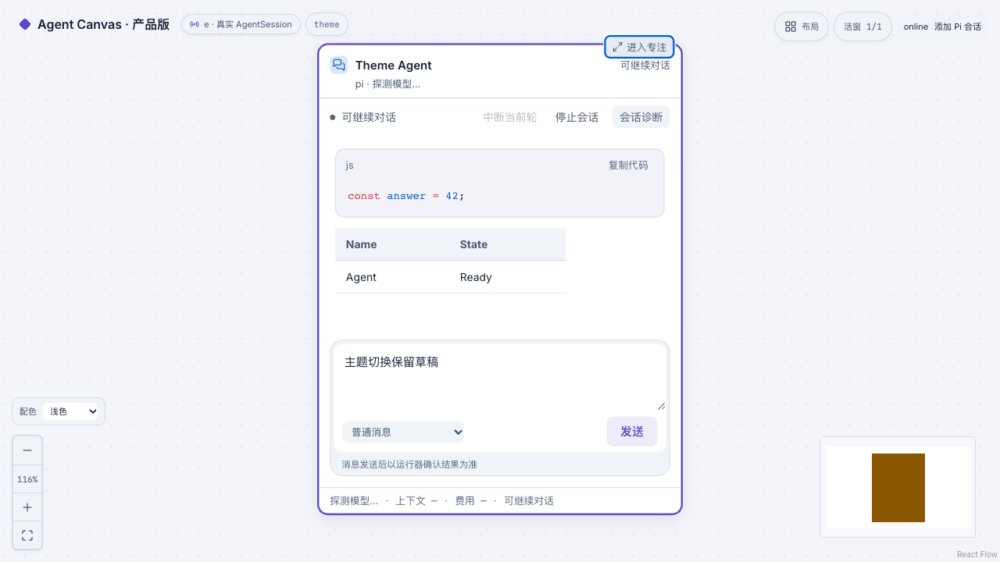
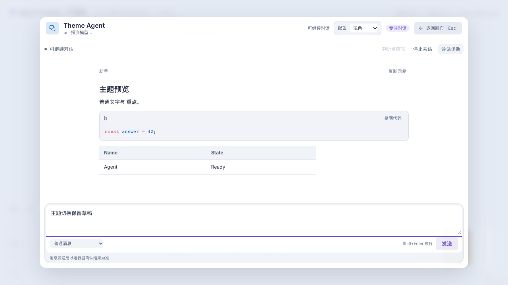
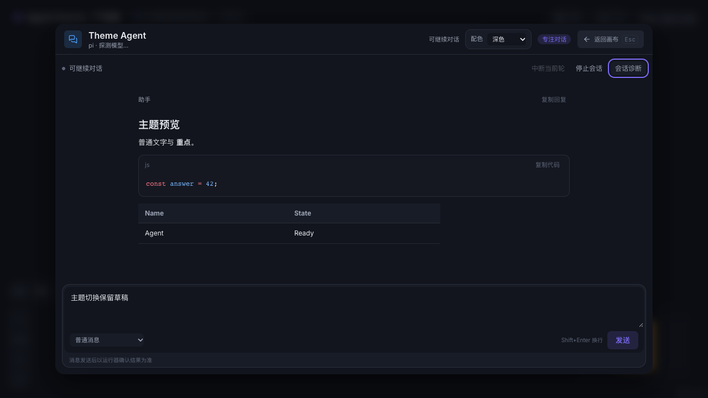

# 全站浅色 / 深色 / 跟随系统

## 使用

全站左下方“配色”选择器（画布缩放按钮上方）支持 **浅色、深色、跟随系统**。浮层与全屏也使用这个全局入口，不再在专注标题栏放置重复选择器。默认跟随系统，用户选择保存在 localStorage `agent-canvas-theme`；刷新、路由切换及同源标签页同步。存储被禁用时仍可在当前页面切换，但不保证刷新后持久化。

主题切换仅影响渲染，不发送模型请求、不重建会话、不改变发送方式；聊天草稿和现有终端实例保留。跟随系统通过 next-themes 实时响应 prefers-color-scheme，显式浅/深色不受系统变化覆盖。

## 实现

- `src/theme/ThemeProvider.tsx`：next-themes class 模式，enableSystem，默认 system；避免换主题时全站过渡闪动。
- `src/theme/ThemeSwitcher.tsx`：原生可键盘操作的全局 select，浮层/全屏时保持可访问。
- `src/index.css`：深色基础 token 与 `:root.light` 浅色覆盖。覆盖画布/网格、surface、文字、状态、边、阴影、overlay、minimap、chart/sidebar/shadcn 和终端颜色。
- 修复原有 `--accent` 同时用作完整颜色与 HSL 数值的冲突；品牌色保留完整 CSS 色值，HSL 通道使用 `--accent-hsl`。
- `CodeBlock`：Shiki GitHub Dark/Light，两套主题按异步资源加载；切换时只重算 token，不重挂载会话或改动代码内容。
- `terminal-theme.ts`：解析当前 CSS token 成 xterm ITheme；LiveTerminal 监听根 class，原地设置 options.theme，不 dispose、不重订阅、不清空 buffer。
- React Flow 的网格/边/minimap 采用 CSS 色值；tldraw user preferences 跟随 resolvedTheme，自绘 canvas minimap 监听主题重绘。
- 弹窗/侧栏/诊断/专注遮罩继承主题 token；Sonner 统一使用 resolvedTheme，修正 HSL token 作为完整颜色的错误。

## 验证

- 浅色主/次/三级文字、品牌色和六态前景在 canvas 与三个 surface 背景的对比度至少 4.5:1。此声明不包含禁用态 opacity、装饰元素或任意用户 ANSI 输出。
- 浏览器验证三态选择、刷新持久化、系统实时变化、显式优先、跨标签页同步及 localStorage 禁用降级。
- 浏览器验证代码高亮实际颜色变化、会话草稿/DOM 保持、专注/诊断配色、minimap mask、xterm 原实例保留与无新增订阅。
- 首页、welcome、React Flow、tldraw 浅色继承检查通过。
- 五项主题浏览器用例在开发与生产单服务均通过；不使用真实模型调用。

## 截图（测试 fixture，非用户数据）

## 后续维护

新增 UI 使用现有 semantic token，不写死深色背景/浅色文字。Canvas2D/xterm 等不能解析 CSS var 的 API 必须使用解析后的 token，主题变化仅重绘。第三方自带 UI 应接 resolvedTheme，避免内部另存一份与应用不同的主题偏好。

开发服务刷新后加载新前端；生产服务需要重新构建静态资源。切换配色不需要重启 API/Pi。

## 主画布的全局卡片入口

主画布中，“配色”旁同时提供全局“卡片”选择器。两者互相独立：颜色改变不修改卡片偏好，卡片默认值改变不修改配色。浮层和全屏共用这组全局入口。单卡覆盖和继承规则见 [卡片视图](card-views-and-approvals.md)。
